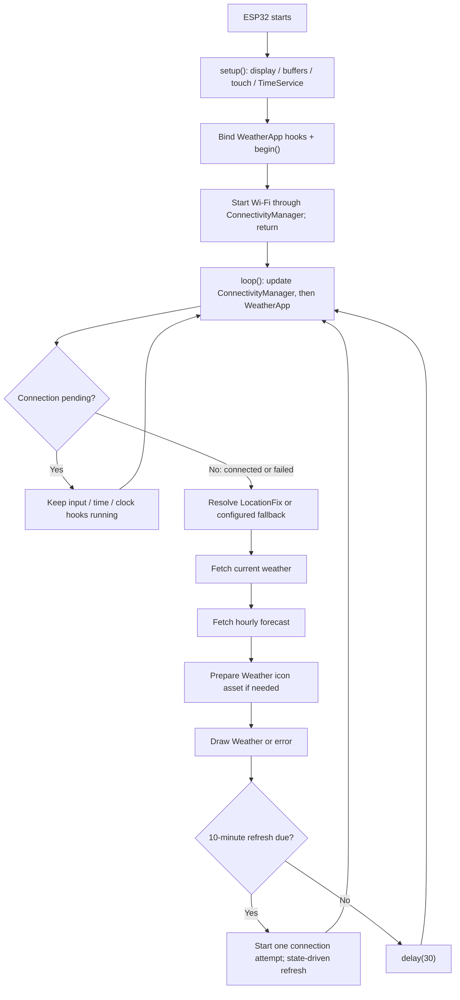
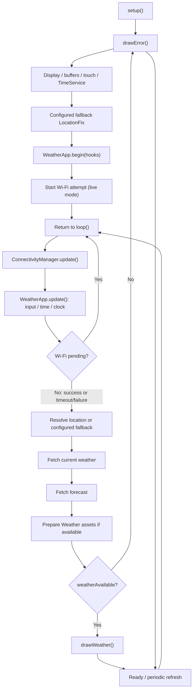
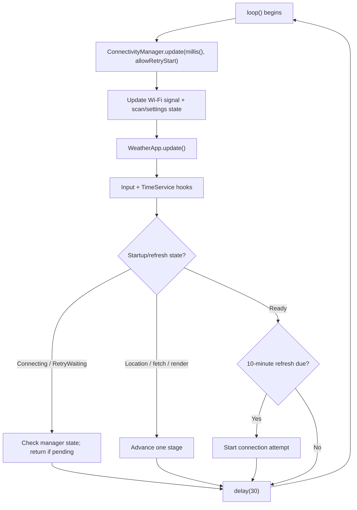
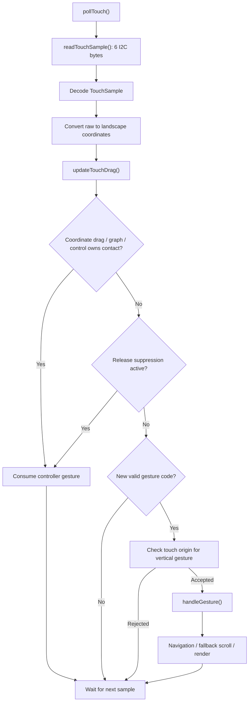
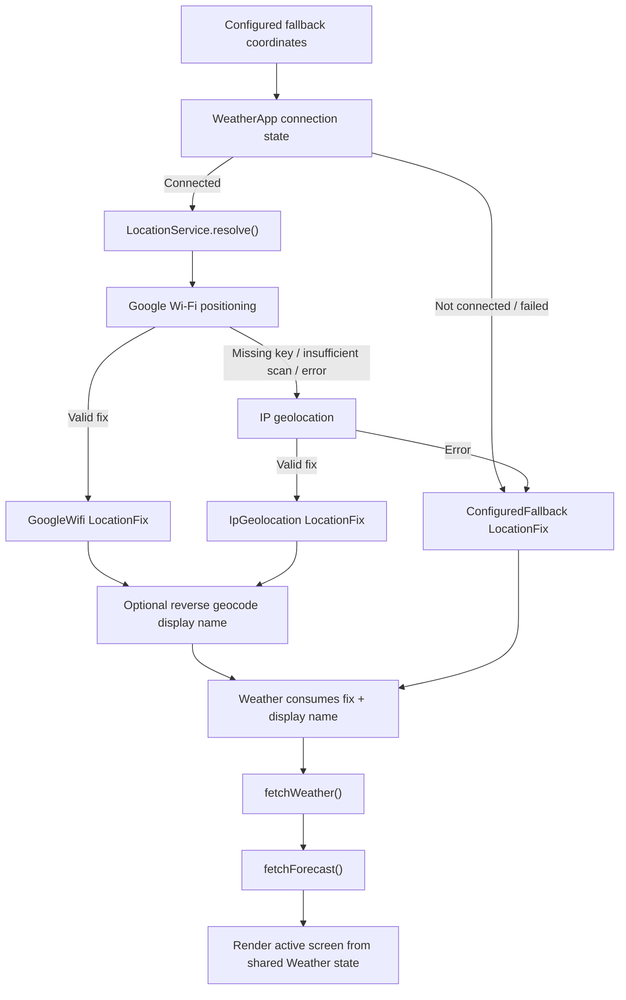

# Phase 0, Step 2 — Runtime data-flow map

**Status:** Complete — static runtime / call-flow trace  
**Roadmap:** [Platform Refactor Roadmap](../PLATFORM_REFACTOR_ROADMAP.md)  
**Related inventory:** [Phase 0, Step 1 — Code inventory](PHASE0_STEP1_CODE_INVENTORY.md)  
**Repository:** `mdrmx/esp32-gadget`  
**Primary runtime entry point:** `weatherDashboard.ino`  
**Service/application/UI modules:** `src/services/HttpRequestClient.h`, `src/services/ConnectivityBackend.h` (PR #52), `src/services/ConnectivityManager.h` (PRs #52/#56), `src/services/WiFiBackend.h` (PR #52), `src/services/WiFiProfileStore.h` and `src/services/PreferencesWiFiProfileStorage.h` (PR #54), `src/services/WiFiNetworkScanner.h`, `src/services/WiFiAvailabilitySnapshot.h` and `src/services/WiFiAvailabilityRefreshPolicy.h` (PR #56), `src/services/WiFiSignalMeter.h` (PR #55), `src/services/WiFiGeolocationScanner.h` and `src/services/Esp32WiFiGeolocationScanBackend.h` (PR #57 branch), `src/services/TimeService.h`, `src/services/LocationService.h`, `src/services/WeatherDataService.h`, `src/apps/weather/WeatherApp.h`, `src/apps/weather/WeatherViewState.h`, `src/apps/weather/WeatherAssetCache.h` (PR #48), `src/ui/ForecastGraphRenderer.h` (PR #49), `src/ui/WeatherMetricsViewportRenderer.h` (PR #50), `src/ui/ForecastListViewportRenderer.h` (PR #51), `src/ui/TextRenderer.h`, `src/ui/HeaderRenderer.h`, `src/ui/StatusScreenRenderer.h` (PR #44), `src/ui/ForecastListItemRenderer.h` (PR #45), `src/ui/WeatherMetricCardRenderer.h` (PR #46) and `src/ui/WeatherConditionsRenderer.h` (PR #47).
**Source checkpoint:** merged firmware baseline `main` includes PR #56 merge `32a9e3908b5af96759590c94cd8a3a123a1ac223`, following the PR #52 connectivity foundation, PR #53 state-driven Weather startup/refresh, PR #54 persistent NVS Wi-Fi profiles and PR #55 on-device Wi-Fi manager. PR #56 adds retry/backoff, saved-profile availability refresh and retained snapshots. PR #57 on `phase2/06-wifi-geolocation-scan-capability` is the current extraction branch.
**Extraction status:** PRs #47–#56 are merged into `main`. The user confirmed all three strict C++11 connectivity/availability suites, Arduino IDE Verify/upload and full physical regression for PR #56. The final build reports 1,202,271 bytes program storage, 100,740 bytes global dynamic memory and 226,940 bytes remaining; the application image hash was verified and the board hard-reset via RTS. PR #57 adds `WiFiGeolocationScanner` and `Esp32WiFiGeolocationScanBackend`: LocationService now receives an injected platform-neutral scan capability, and its Google AP validation/deduplication/strongest-15 selection is isolated from ESP32 APIs. The local strict C++11 scanner suite passed. PR #57 Arduino IDE Verify/upload and physical Google/IP/fallback regression remain outstanding. The NVS source-isolation test replaced the compiled `secrets.h` Wi-Fi values with invalid credentials; the device still loaded its preferred profile and completed Google Wi-Fi positioning plus OpenWeather reverse geocoding. The original local `secrets.h` was restored and normal firmware uploaded again. NVS/flash encryption is not enabled by this code. Compile-time/image-size figures are not runtime heap/PSRAM measurements. Wi-Fi association is state-driven, but Google geolocation scanning, IP geolocation, HTTP/TLS, due TimeAPI sync and icon preparation remain synchronous stages.

**Review date:** 2026-11-25 (PRs #52–#56 merged; PR #57 geolocation scan extraction in review)

---

## 1. Scope and method

This document completes Phase 0, Step 2: trace how the existing firmware behaves at runtime and how input, application state, network responses and rendering connect.

The trace follows the merged Weather sketch and extracted services through PR #51, including the Weather asset-cache owner, pre-render icon preparation hook, ForecastGraphRenderer, WeatherMetricsViewportRenderer and ForecastListViewportRenderer. The view renderers consume existing Weather forecast/metric records through callbacks; Weather retains application data, scroll/gesture/animation policy, canvas lifecycle and full-screen composition. PRs #50 and #51 are now host-tested, firmware-verified and physically validated on merged `main`; their exact validation and build footprint are recorded below. The map covers startup, repeating `loop()`, touch sample decoding, drag ownership, gesture dispatch, screen rendering, network requests, location resolution and time synchronisation.

This is a **static source-level runtime map**. It does not claim that the firmware was compiled, profiled, or tested on the physical Waveshare board during this step. Timing values below are configured timeout / scheduling values in the source, not measured network latency or observed responsiveness.

### Snapshot

| Item | Observed |
|---|---:|
| Sketch size | 47 lines |
| Current source blob | `1cd98bd7575854bb2f796b70b9ed5cb451da578e` |
| Main entry points | `setup()` and `loop()` |
| Main display tabs | Current Weather and Hourly Forecast |
| Weather refresh interval | 600,000 ms (10 minutes) |
| Loop idle delay | 30 ms |
| Clock header check | 1 second |
| Time API resynchronisation | 6 hours |
| Time API retry interval | 5 minutes |
| Forecast storage capacity | 48 records |
| Forecast list page | 3 records |
| Forecast graph viewport | 6 points |
| Canvas buffers | 3, allocated in `setup()` |

The Step 1 inventory records the complete function and global-state inventory. This document focuses on how those functions call one another and how the shared global state moves between them.

## 2. Runtime architecture at a glance

There is no application manager or platform service layer in the current sketch. The Arduino setup / loop model is the top-level scheduler. The Weather dashboard owns the device-wide display, touch, network and time paths directly.

The main global state groups and their current responsibilities are:

| State group | Representative globals | Current role |
|---|---|---|
| Connectivity / credentials | `wifiSsid`, `wifiPassword`, `apiKey` | Compile-time credentials and OpenWeather API key |
| Location | `LocationService::LocationFix`, `currentLocationFix`, plus Weather's `locationLat`, `locationLon`, `locationDisplayName`, `locationCoordinatesResolved` | Provider/source/accuracy/observation/validity result, plus existing Weather-facing coordinates and preferred display name |
| Time | `TimeService`, Weather's header redraw cache, `locationTimezoneOffset` | Device clock validity/synchronisation and UK civil time; provider-local forecast offset remains separate |
| Current weather | `temperature`, `feelsLike`, `humidity`, `weatherDescription`, `weatherIcon`, `weatherAvailable` | Current Weather screen and metric-card content |
| Forecast | `forecast[]`, `forecastCount`, `forecastAvailable`, `forecastError` | Fixed-capacity hourly data store and availability state |
| Navigation / presentation | `currentTab`, `forecastGraphView`, `weatherMetricOffset`, `forecastOffset`, `forecastGraphScrollPixels` | Active view and scroll positions |
| Touch interaction | metric, forecast and graph candidate / active / suppression globals | Ownership, axis intent, drag positions, release and duplicate-gesture suppression |
| Display | `gfx`, three canvas pointers, `screenW`, `screenH` | Physical display access, off-screen rendering and transition composition |

These groups are all held in file-scope variables. Their current ownership is therefore implicit: multiple functions can read or mutate the same values.

## 3. Startup sequence — `setup()`

The merged PR #52 baseline had a synchronous Wi-Fi association before WeatherApp startup. On the follow-up branch `phase2/02-nonblocking-weather-startup`, connection acquisition is state-driven; location and data work still run synchronously in separate WeatherApp update stages.

1. **Serial and Wi-Fi profile initialisation.** Serial starts, then `initialiseWiFiProfiles()` reads the versioned Preferences/NVS profile record. If the key is absent, it attempts a one-time import from `secrets.h`; the selected credentials are copied into device-lifetime RAM before the backend borrows them. Corrupt/unsupported stored data is not overwritten. Demo mode skips NVS profile loading.
2. **Display and canvas startup.** The display is initialised, logical dimensions are read and the forecast, weather-metrics and tab-transition canvases are allocated with their existing fallback behaviour.
2. **Memory diagnostics.** The sketch reports framebuffer memory regions plus PSRAM and internal-heap summaries.
3. **Touch-controller detection.** The CST816 reader initialises the touch interface. If the controller is unavailable, display and network startup continue while touch polling returns immediately.
4. **Time service setup.** `timeService.begin()` configures the Europe/London timezone/DST rule. This does not itself establish a valid clock. The existing `maybeSyncTimeFromAPI()` caller delegates synchronisation and retry policy to `TimeService::syncIfDue()`.
5. **Demo or live startup.** In demo mode, `TimeService::setDemoTime()` sets the fixed development timestamp and the Wi-Fi/location callbacks take the offline fixture path. In live mode, `setup()` injects platform and Weather operations into `WeatherApp::Hooks`; it does not wait for Wi-Fi or resolve location.
6. **Weather application startup.** `WeatherApp::begin()` starts one connection attempt through the injected callback, draws the connecting state and returns to the device setup path. The platform `loop()` continues polling `ConnectivityManager` and calling `WeatherApp::update()`.
7. **Initial Weather data and render.** While the connection is pending, Weather continues input, time-sync and clock hooks. When connected or the attempt fails/times out, the app advances through location resolution, current-weather fetch, forecast fetch, optional Weather icon preparation and first render. Each stage is scheduled on a separate update call; the LocationService, HTTP/TLS and asset-preparation calls themselves remain synchronous during their stage.

### Startup flow detail

### Important startup nuance

On the follow-up branch, `WeatherApp::begin()` only starts the connection attempt; `loop()` polls the Connectivity Manager and then calls `WeatherApp::update()`. The app runs the time-sync hook during the pending-connection state, but TimeService sees the current disconnected status and does not have to wait for association. When association succeeds, the next update advances to location resolution and then to current/forecast retrieval.

If the initial connection attempt fails or times out, the resolver selects the configured fallback coordinates and does not make another IP-geolocation request without a network. The current-weather adapter follows the existing stale-data / Wi-Fi-unavailable path and the forecast adapter marks forecast unavailable. The periodic refresh flow may initiate a new single connection attempt on its next scheduled cycle; the fetch adapters themselves do not start additional Wi-Fi attempts.

## 4. Main loop and scheduling

The device `loop()` is the platform scheduler: it calls `connectivityManager.update(millis(), allowRetryStart)`, where manager-initiated retries are deferred only while `WiFiNetworkScanner` is actively scanning; it then updates the Wi-Fi signal indicator and settings/scanner state, advances `weatherApp.update()`, and retains the 30 ms pacing delay. `WeatherApp` runs the Weather-owned input/time/connection/startup/refresh sequence through injected hooks. During pending Wi-Fi association and manager-owned retry backoff, input and time hooks continue on each loop pass. While Saved Profiles is visible, `updateWiFiSettings()` also runs the asynchronous availability-refresh policy: immediate scan on entry, 30-second cadence, 5-second retry after scan failure, and an immediate scan on connected/disconnected edges. `WiFiAvailabilitySnapshot` retains the last successful SSID set while a check is in progress or fails, so the saved rows keep their previous AVAILABLE/UNAVAILABLE badges during the scan; they are redrawn only on a connection edge or when the new scan completes. No CHECKING badge is displayed. Location, HTTP/TLS, icon-asset and rendering operations remain synchronous when their individual state executes.

| Activity | Trigger / cadence | Behaviour |
|---|---|---|
| Weather application update | Every device loop pass | `weatherApp.update()` coordinates the Weather hooks |
| Touch polling | Every WeatherApp update | Read and interpret one CST816 sample when touch is available |
| Wi-Fi settings / scan update | Every device loop pass | Advance async scans; Saved Profiles refreshes on entry, every 30 s, after link-state edges and retries failures after 5 s. Last-known badges remain visible until new results complete. |
| Time sync check | Every WeatherApp update | Check Wi-Fi state and determine whether a TimeAPI request is due |
| Header clock | At least once per second | Re-read the system clock; redraw only if the displayed minute string changed |
| Weather refresh | Every 600,000 ms | Fetch current conditions, then hourly forecast, then redraw the active tab |
| Idle pacing | Every device loop pass | `delay(30)` after the WeatherApp update |

The ten-minute interval is `WeatherApp::DefaultRefreshIntervalMs = 600000UL`. `WeatherApp` assigns its refresh timestamp **before** the two fetch operations begin, preserving the previous cadence. If a refresh takes long enough to cross another interval boundary, the next update can find the refresh due again; there is no separate refresh-complete timestamp. `weatherDashboard.ino` now delegates recurring work to `weatherApp.update()` and retains only the device-level 30 ms loop pacing.

The manager permits two retries after the initial association attempt, using 2 s then 4 s delays (8 s cap) and the existing 20 s per-attempt timeout. A driver reconnect during the backoff window is accepted immediately; an explicit disconnect cancels the retry sequence. It does not silently roam across saved profiles: the preferred profile is selected at startup, and UI-selected candidates are promoted only after successful association.

The loop is not a fixed-rate real-time scheduler. The nominal 30 ms delay is reached only after touch processing, time checks, rendering and any network activity have returned.

Persistent Weather presentation state is now stored in `WeatherViewState`: the active main-tab index, metric-card offset, forecast-list offset, graph hour/pixel offsets and List/Graph mode. The sketch currently uses temporary reference aliases with the former global names, so renderer and gesture call sites keep their existing control flow. Canonical tab-reset and forecast-mode-switch rules are methods on the state object. Contact/drag candidates, transient drag pixels, hit-testing, suppression and animation timing remain touch/view interaction policy in the sketch.

## 5. Touch and interaction data flow

### 5.1 Hardware sample to logical screen coordinates

`pollTouch()` is the touch entry point and calls `readTouchSample()`. The reader selects the CST816 gesture register and reads six bytes in one I²C transaction. The bytes become the `TouchSample` fields:

- `gesture` — controller gesture code.
- `fingerCount` — low nibble of the finger-count register.
- `event` — top two bits of the event register (0 down, 1 up, 2 contact).
- `rawX` and `rawY` — 12-bit coordinate values assembled from register nibbles and bytes.

The panel reports coordinates in its portrait-native frame, while the display is used in landscape. `touchCoordinatesToScreen()` maps them as:

- `screenX = rawY`
- `screenY = screenH - 1 - rawX`

Both values are constrained to the logical display bounds.

A touch is treated as present when `fingerCount > 0` and `event != 1`. Touch-up coordinates are deliberately ignored. Failed or incomplete I²C reads do not create a new sample; `pollTouch()` returns without dispatching a gesture.

### 5.2 Touch ownership and gesture arbitration

The important sequence is:

1. `pollTouch()` obtains the sample and records raw gesture-register transitions for diagnostics.
2. `updateTouchDrag()` processes coordinate movement, touch-down origin, candidate states, drag states, release/snap behaviour and control taps.
3. Back in `pollTouch()`, the controller gesture code is checked against active touch ownership and suppression windows. If an in-progress drag, graph-owned contact, selector press or release suppression owns the interaction, the controller gesture is consumed.
4. A zero gesture clears the duplicate-gesture latch. A non-zero, changed gesture within the configured CST816 gesture-code range is passed to origin checks and then `handleGesture()`.
5. `handleGesture()` applies a 250 ms rate limit and maps the accepted controller code to navigation or legacy scrolling.

This arbitration exists because a single physical contact can produce both coordinate movement and a completed CST816 gesture. Without suppression, one drag could be applied twice.

### 5.3 Current-weather metric cards

Coordinate-tracked metric dragging is enabled only when the touch starts in the metrics panel, the current tab is Weather, and `weatherMetricsCanvas` is available.

- A touch-down creates a candidate; it does not immediately claim the gesture.
- Movement of at least 8 px on the horizontal axis, greater than vertical movement, resolves as a horizontal swipe and returns control to normal tab gesture handling.
- Movement of at least 8 px vertically, with vertical movement at least as large as horizontal movement, activates the coordinate-tracked metric drag.
- The scroll position follows the inverse finger Y delta, with resisted overscroll capped by the shared 20 px limit.
- On release, the scroll position is rounded to the nearest metric row and snapped. The completed controller gesture is suppressed for 300 ms.

If the metrics canvas is unavailable, coordinate-tracked metric dragging is not started. The older gesture-only fallback remains available, but vertical gesture origin is still required to be inside the metrics panel.

The metrics viewport renders through `weatherMetricsCanvas` when available and when not composing a tab transition. Otherwise the same metric-item renderer draws directly to `gfx` with clipping.

### 5.4 Forecast list

Coordinate-tracked list dragging requires all of the following at touch-down:

- Forecast tab active and List mode selected.
- Forecast canvas allocated.
- Forecast data available with more than the three visible entries.
- Touch begins inside the forecast viewport, away from the outer horizontal edges.
- No forecast selector press has claimed the contact.

The candidate uses the same 8 px axis-intent threshold as metric scrolling. Vertical movement activates the drag; horizontal movement releases the candidate so the normal tab swipe can be handled.

The scroll follows the finger's Y delta with elastic overscroll. The display redraw is rate-limited to `FORECAST_DRAG_RENDER_INTERVAL_MS` (50 ms), and the deadline is checked even when the finger stops moving. On release, the list snaps to the nearest valid row and suppresses the controller's duplicate gesture for 300 ms.

If the canvas is unavailable or the other candidate requirements are not met, the gesture-only fallback can still scroll the list, gated by the touch origin being inside the list viewport.

### 5.5 Forecast graph

Graph interaction has a different ownership model because horizontal movement is used both for graph panning and for returning to the Weather tab.

- A touch starting in the graph body (below the selector strip and within the forecast viewport) is owned by the graph until release, even if coordinate tracking drops temporarily.
- A clear horizontal movement of at least 55 px before the 220 ms hold threshold is treated as a quick tab swipe. A rightward movement returns from Forecast to Weather.
- Otherwise, after the 220 ms hold delay, horizontal movement of at least 4 px activates graph dragging. The graph scroll follows the finger horizontally with the same elastic-scroll helper and 50 ms render throttling.
- A strong vertical movement of at least 20 px before the hold threshold cancels graph panning, but the contact remains graph-owned so a lost coordinate sample cannot fall through into an unintended tab gesture.
- On release after a graph drag, the scroll snaps to the nearest 56 px hourly point.
- After any graph-owned release, the CST816 controller gesture remains suppressed until the gesture register has returned to zero for the required quiet interval. A new touch-down explicitly begins a new interaction sequence and clears the previous latch.

The standard controller vertical gestures are ignored in graph mode. Graph panning is coordinate-tracked; the legacy vertical forecast gesture path does not apply there.

### 5.6 Forecast selector

The selector records a control press when touch-down is in its hit region and within the List / Graph segments. Movement exceeding the 40 px tap slop cancels the selector press so a deliberate swipe can still be interpreted by the normal gesture path.

On release, control 3 selects List and control 4 selects Graph. `handleForecastControlTap()` resets both list and graph scroll positions to the beginning, changes `forecastGraphView`, redraws the forecast screen and suppresses the resulting controller gesture.

### 5.7 Legacy gesture mappings

After touch-origin and suppression checks, `handleGesture()` handles the remaining controller codes:

| Raw controller code | Current Weather tab | Forecast tab |
|---|---|---|
| `GESTURE_SCREEN_RIGHT` | Opens Forecast | No tab change |
| `GESTURE_SCREEN_LEFT` | No tab change | Returns to Weather |
| `GESTURE_SCREEN_UP` | Advances metric cards | Advances forecast list by one row; ignored in graph mode |
| `GESTURE_SCREEN_DOWN` | Moves metric cards backward | Moves forecast list backward; ignored in graph mode |

The comments in the code describe these as provisional physical-direction mappings. The mapping above records the raw code-to-action behaviour, rather than assuming every panel reports physical direction identically.

## 6. Rendering and display data flow

Rendering is initiated directly by the startup path, refresh path, touch handlers, gesture handlers and selector tap handler. There is no separate render queue or application view interface.

### 6.1 Current Weather

`drawWeather()` sets `currentTab` to Weather, clears the display, draws the header, then renders:

1. Weather icon.
2. Wrapped condition description.
3. Temperature.
4. Feels-like temperature.
5. Weather metric-card viewport.
6. Tab indicator.

The displayed values are read from the global current-weather fields populated by `fetchWeather()` and `fetchForecast()`.

The current-condition text stack is delegated to the merged `WeatherConditionsRenderer`. Weather draws/decodes a provider icon if the matching asset is already cached, then supplies its returned height and the already-formatted description, temperature and feels-like strings. The renderer owns only responsive text wrapping, placement and spacing through `TextRenderer`; it does not select data, fetch/decode icons, draw the metric viewport or compose the full screen.

**PR #48 asset-cache change:** `WeatherApp` now calls an optional `prepareWeatherAssets` hook after current-weather and forecast retrieval and before rendering the selected view. The sketch's `prepareWeatherIconAsset()` uses the existing synchronous `HttpRequestClient` transport to populate `WeatherAssetCache`; the cache owns the icon code and allocated PNG buffer. `drawOpenWeatherIcon()` only reads a matching cached entry and passes it to PNGdec. A miss or failed download returns zero icon height and leaves the safe no-icon layout in place; a later preparation pass can retry. PNG line callbacks draw through `DisplayManager::target()`, including the tab-transition canvas.

Consequently, the Weather drawing path no longer initiates network I/O. A cache-miss download can still block, but it occurs in the explicit pre-render preparation step before the selected Weather screen is drawn; tab-transition composition only reads and decodes the cached asset.

### 6.2 Weather metric viewport

`drawWeatherMetricsViewport()` composes the visible metrics and neighbouring partial cards. On merged `main` at PR #50, the sketch selects `weatherMetricsCanvas`, clears/flushes it where available, and uses direct drawing during transition composition or when the canvas is unavailable. `WeatherMetricsViewportRenderer` now owns visible-row selection, base-offset bounds, per-row positioning, viewport background fill and card drawing delegation. Weather supplies one formatted metric item at a time and retains metric selection/formatting, panel geometry, render-target/canvas selection, flush/fallback, scroll positions, drag/snap animation and tab-transition composition. The renderer reuses one `Item` across the visible row loop so Arduino `String` buffers can retain capacity. The strict C++11 runner, Arduino Verify, upload/boot and physical Waveshare regression all passed for PR #50.

### 6.3 Forecast viewport — List and Graph

`drawForecast()` sets `currentTab` to Forecast, clears the screen and draws the header. If no hourly data is available, it shows `forecastError` (or a generic no-data message), then draws the selector and footer.

When data is available, `drawForecastViewport()` renders the viewport:

- In List mode, Weather supplies forecast items from `WeatherForecastData` through `readForecastListItem()` and the `ForecastListItemRenderer` draws each card.
- In Graph mode, `drawForecastGraph()` delegates the temperature line, hourly points, precipitation bars and associated labels to the merged `ForecastGraphRenderer`.
- With `forecastCanvas` available and not composing a tab transition, Weather clears the canvas, draws the selected view and flushes it; canvas ownership and flush remain outside the view renderers.
- If the canvas is unavailable or a tab transition is being composed, Weather selects the direct-display path. List mode uses the settled-row fallback; Graph mode draws directly to the current render target.

The graph maintains a continuous pixel scroll position (with a corresponding hourly offset), while list mode uses row offset plus within-row pixels. Weather retains both modes' scroll state, clamping, touch/gesture policy and animations.

**PR #51 merged implementation and validation:** Forecast List-mode row-window selection, base-offset bounds, row positioning and partial-card clipping are delegated to `src/ui/ForecastListViewportRenderer.h`. The buffered path selects neighbouring partial rows and visible settled rows, then calls the existing `ForecastListItemRenderer::drawClipped()`; the direct-display/transition fallback intentionally draws only settled rows to preserve the no-canvas behaviour. The sketch callback reads the existing `WeatherForecastData` record and formats the compact time label. Weather keeps List/Graph selection, graph composition, viewport clearing and canvas selection/flush, direct-fallback choice, scroll/gesture/animation policy, controls/footer and full screen/transition composition. The strict C++11 runner `sh scripts/test-forecast-list-viewport-renderer.sh` passed on merged `main`; the companion metrics viewport runner also passed. The user confirmed Arduino IDE Verify, upload/boot and physical Waveshare regression passed on 2026-11-25. Latest Verify: 1,167,139 bytes program storage, 97,444 bytes global dynamic memory and 230,236 bytes remaining. The Verify log reused cached objects before successful linking/image generation. The PR description's unchecked-at-merge boxes are superseded by the post-merge results; the merge commit had no CI status checks.
### 6.4 Tab transition composition

`animateTabTransition()` resets all scroll positions, swaps the global `gfx` pointer to `tabTransitionCanvas` temporarily, and calls the destination screen renderer to compose an off-screen full-screen frame. It then restores the live display pointer and slides the central content area across the physical display over eight frames with a 9 ms delay per intermediate frame.

If the transition canvas or its framebuffer is unavailable, the destination screen is drawn directly with no animated transition.

This is another example of implicit display ownership: screen renderers do not receive a display target consistently; they normally use the global `gfx` pointer, which the transition function temporarily redirects.

## 7. Network, location and weather data flows

### 7.1 Connectivity

`ConnectivityManager` owns the connection attempt state and timeout behind the transport-neutral `ConnectivityBackend` contract. `WiFiBackend` implements the ESP32 station operations; Weather does not call `WiFi.mode()` or `WiFi.begin()` directly.

- `connectivityManager.connect(nowMs)` starts the backend connection attempt and returns without waiting.
- `connectivityManager.update(millis(), allowRetryStart)` is called by the platform loop on every pass. It polls connection state, marks connection success, detects link loss, mirrors backend/driver background reconnection and enforces the 20-second timeout. The manager permits two retries after the initial attempt, using 2 s then 4 s delays (8 s cap); a driver reconnect during backoff is accepted immediately, and an explicit disconnect cancels the retry sequence. The loop sets `allowRetryStart` false only while the asynchronous Wi-Fi scan is active.
- In the merged PR #52 baseline, `connectWiFi()` wrapped these APIs in a synchronous compatibility wait. The follow-up branch `phase2/02-nonblocking-weather-startup` removes that helper entirely.
- In the follow-up branch, `WeatherApp::begin()` calls an injected connection-start hook and returns. The platform loop then updates the manager and WeatherApp. During `Connecting`, Weather continues to run its input, time-sync and clock hooks. Once connected or the attempt ends, Weather advances through location, current-weather, forecast, asset-preparation and initial-render states.
- The same state-driven connection check is used during periodic refresh. Current/forecast data adapters read the current connection state and do not initiate new association attempts.

The merged PR #54 implementation adds `WiFiProfileStore` and `PreferencesWiFiProfileStorage`. The store holds up to five networks in one versioned CRC32-protected NVS blob, supports preferred selection, same-SSID credential replacement and forget semantics, and rejects corrupt/unsupported records without overwriting them. At first boot only, a missing profile key triggers migration from the ignored `secrets.h`; a valid empty profile set is not repopulated from compile-time credentials. The selected profile is copied to device-lifetime RAM because `WiFiBackend` borrows its SSID/password pointers. Both strict C++11 host suites passed before and after final review fixes; Arduino IDE Verify and upload/hash verification passed on the recorded implementation build. Physical testing confirmed boot, reset/reconnect, existing interactions and the invalid-`secrets.h` source-isolation proof; the original secret file and normal firmware were restored. The final review-fixed upload again logged `[WIFI] Loaded the saved preferred network profile.` All five inline review comments were answered and resolved. The implementation does not enable NVS/flash encryption. The merged Wi-Fi manager provides profile selection and scanning; draft PR #56 adds bounded retry, periodic/connection-edge refresh and a last-successful availability snapshot. Open-network passwords continue to be passed as `nullptr` to the ESP32 Wi-Fi driver. `LocationService` still uses direct Wi-Fi scan/BSSID/RSSI APIs for Google Wi-Fi positioning, and `HttpRequestClient` remains tied to `WiFiClientSecure`; those are separate boundaries from connection lifecycle.

**Follow-up branch scope limit:** this removes the Wi-Fi association wait from the WeatherApp call stack, not all network blocking. `LocationService` geolocation, TimeService's due TimeAPI request, current/forecast HTTP/TLS requests and icon asset downloads remain synchronous while their individual hooks/stages execute.

### 7.2 Location resolution

The live startup location chain is orchestrated by `LocationService::resolve()` in `src/services/LocationService.h`. On the PR #57 branch, scan capability and platform access are separated:

1. Start with the configured default coordinates: latitude 53.4808, longitude -2.2426. The sketch creates a `ConfiguredFallback` fix before attempting live providers.
2. The Weather composition hook supplies the current network-connected state. `LocationService` uses that value to decide whether live providers may run; it no longer queries `WiFi.status()` directly.
3. If the Google Geolocation API key is available, `LocationService` asks its injected `WiFiGeolocationScanner` to scan for candidate access points. The scanner applies the platform-neutral eligibility rules, removes duplicate BSSIDs, sorts by signal strength and retains up to 15.
4. `Esp32WiFiGeolocationScanBackend` performs the existing passive synchronous ESP32 scan (`WiFi.scanNetworks(false, false, true, 120)`), copies each readable BSSID/RSSI/channel observation into a value record and releases the driver's scan results. Google requires at least two eligible access points. The scanner and backend use bounded fixed storage; the scan remains synchronous.
5. The Google request sends `considerIp: false` and access-point BSSID, signal strength, channel and age values. No connection to those nearby networks is made. Valid Google coordinates are range-checked and returned with source `GoogleWifi`, an observation time from `millis()`, and an optional accuracy radius when Google's response supplies one. OpenWeather reverse geocoding is attempted for a display name and never replaces the coordinates.
6. If Google positioning is unavailable or fails, the service requests `https://ipwho.is/`. Valid coordinates are returned with source `IpGeolocation`, no claimed accuracy radius, an observation time and the provider city as an initial display-name fallback. OpenWeather reverse geocoding is then attempted.
7. If both providers fail, the configured coordinates are returned with source `ConfiguredFallback`. The existing current-weather response can still supply its reporting-station coordinates only while `locationCoordinatesResolved` is false.

The `LocationFix` validity flag describes whether the returned coordinates are in range. `observedAtMs` is a monotonic observation timestamp relative to the current boot, not a calendar timestamp. IP geolocation remains coarse and is not represented as equivalent to Wi-Fi or future GNSS positioning. The PR #57 extraction has passed its local strict C++11 host suite; Arduino Verify/upload and physical Google/IP/fallback regression are pending.

The header continues to prefer `locationDisplayName`, then `weatherCity`, then the configured `CITY` value. The current-weather provider's city name and the location display name remain separate because the weather station name may refer to a nearby reporting location.

### 7.3 Current weather request

`fetchWeather()` loads the local fixture immediately in demo mode. In live mode it:

1. The WeatherApp state machine first waits for the platform connection attempt to complete or fail; `fetchWeather()` does not start Wi-Fi itself.
2. In live mode, if there is no current network, the adapter displays stale Weather data when available or a Wi-Fi error when no data exists.
3. When connected, it displays a loading message.
4. GETs OpenWeather current conditions using the stored latitude / longitude, API key and metric units.
4. Parses the response and updates current-weather globals: place / condition / icon, temperature, feels-like, humidity, pressure, wind speed, cloud cover, visibility and rainfall.
5. Updates `locationTimezoneOffset` from the response. If location was not resolved earlier, it may adopt the coordinates supplied by the current-weather response.
6. Sets `weatherAvailable` true when parsing succeeds.

The response wind speed is converted from metres per second to kilometres per hour before it is stored in `windSpeedKmh`.

### 7.4 Hourly forecast request

`fetchForecast()` also bypasses the network in demo mode. In live mode it:

1. The WeatherApp state machine has already completed its connection stage; `fetchForecast()` does not start or wait for Wi-Fi itself.
2. Resets forecast count, error text and the current UV / precipitation-probability availability flags.
3. Requests the OpenWeather One Call 4.0 one-hour timeline endpoint.
4. Follows the response's `next` URL for up to three pages, stopping at the 48-record capacity, an empty next URL or a page failure.
5. Deduplicates records by timestamp and stores each valid entry in the fixed `forecast[]` array.
6. Updates the current UV index and current precipitation probability from the first valid hourly record when those values are supplied.
7. Updates `locationTimezoneOffset` from the One Call response and calculates the list / graph scroll bounds after retrieval.
8. Sets `forecastAvailable` according to whether at least one valid record was stored. Failure reason is retained in `forecastError`.

The list displays up to three records at once. The graph uses six visible hourly points, spaced 56 px apart.

### Location and weather flow

## 8. Time and forecast timezone flow

There are two distinct time concepts in the current sketch.

### Device clock / header time

- `timeService.begin()` configures the device for Europe/London time, including UK daylight-saving rules.
- `maybeSyncTimeFromAPI()` supplies the current Wi-Fi-connected state and scheduler time to `TimeService::syncIfDue()`. The service owns the TimeAPI request, response validation, London wall-clock-to-epoch conversion and ESP32 system-clock update.
- Before the first valid sync, TimeService retries no more often than every five minutes. After a successful sync, the normal resynchronisation interval is six hours; a failed due sync is retried no more often than every five minutes.
- `timeService.headerClockText()` reads the system epoch and converts it with `localtime_r()`. It returns `--:--` if the system time is not valid.
- `refreshHeaderClock()` runs on the one-second loop check, but redraws the clock region only when the displayed text changes.

### Forecast time labels

Hourly timestamps are formatted using `locationTimezoneOffset` from the OpenWeather response, with UTC conversion after applying that offset. This is separate from the Europe/London timezone configured for the system header clock. A device located outside the UK can therefore display forecast-local times while the header remains in the device's configured UK timezone.

## 9. Blocking operations and responsiveness

The current implementation runs touch processing, time synchronisation, network requests and rendering sequentially on the Arduino loop / call stack. The sketch does not define an asynchronous request queue or a dedicated application-level network task.

The following are source-configured bounds / timeouts. They are not guarantees of total operation duration, and nested calls can make a complete startup or refresh much longer. On the follow-up branch the Wi-Fi association timeout is checked from `loop()` without a blocking wait. Time sync, location, HTTP/TLS and icon requests still block the loop while their individual operation executes.

| Operation | Source-configured wait / timeout |
|---|---:|
| Wi-Fi association | 20 s manager timeout; application loop does not wait/poll with a blocking delay on the follow-up branch |
| TimeAPI.io request | 5 s connect timeout and 5 s request timeout |
| Google Geolocation request | 10 s connect timeout and 12 s request timeout |
| IP geolocation request | 8 s connect timeout and 8 s request timeout |
| OpenWeather reverse geocoding | 8 s connect timeout and 8 s request timeout |
| OpenWeather current weather | 15 s connect timeout and 15 s request timeout |
| OpenWeather One Call page | 15 s connect timeout and 15 s request timeout per page; up to 3 pages |
| OpenWeather icon download | 10 s connect timeout and 10 s HTTP timeout; manual body-read deadline up to 8 s |

The icon loader also allocates a heap buffer sized from the HTTP content length (accepted range: greater than 8 and no more than 20,000 bytes). It waits for all expected bytes, validates the PNG signature and replaces the previous cached icon buffer after a successful download.

Other intentional blocking work includes:

- The seven-frame metric scroll animation (8 ms delay per frame).
- The six-frame metric snap animation (8 ms delay per frame).
- Forecast and graph snap / scroll rendering.
- The eight-frame tab transition (9 ms delay on intermediate frames).
- The 30 ms delay at the end of every loop pass.

### Consequences for the platform refactor

- A time-sync check inside `WeatherApp.update()` can perform HTTPS work after the network becomes available and delay subsequent touch samples. While Wi-Fi association is pending, TimeService receives the disconnected state and does not need to wait for the connection.
- A Weather refresh performs current conditions and forecast retrieval serially. The forecast may require multiple paginated HTTP requests.
- On `main` after PR #48, icon downloads and heap allocation occur in the explicit WeatherApp pre-render asset-preparation hook after data retrieval, and only when the Weather view is selected. `drawWeather()` is limited to a matching cache lookup plus PNG decode/display and uses the no-icon fallback on a miss.
- On the merged PR #52 baseline, `connectWiFi()` draws UI as a side effect. The follow-up branch removes that helper and starts connection from the WeatherApp state machine; fetch functions still retain some loading/error/stale-data presentation side effects.
- Touch handlers call renderers and animation functions directly; some of those paths include explicit delays.
- The loop's 30 ms delay does not bound touch latency because the work before it is not time-bounded by the loop itself.

These are source-level reasons to investigate a queued / state-driven network service and a predictable update/render schedule before the platform adds more apps. Phase 0 still needs actual responsiveness measurements on the device.

## 10. Current external request map

| Purpose | Function | Provider / endpoint | Method |
|---|---|---|---|
| System time | `TimeService::syncIfDue()` (request handled internally) | TimeAPI.io, Europe/London current time | GET |
| Weather condition icon | `prepareWeatherIconAsset()` → `downloadOpenWeatherIconPNG()` (PR #48) | OpenWeather icon PNG URL | GET |
| Location place name | `LocationService::resolveLocationNameFromCoordinates()` | OpenWeather reverse geocoding v1.0 | GET |
| Wi-Fi positioning | `LocationService::resolveFromWiFi()` | Google Geolocation API | POST |
| IP positioning | `LocationService::resolveFromIP()` | ipwho.is | GET |
| Current conditions | `fetchWeather()` | OpenWeather current weather 2.5 | GET |
| Hourly forecast | `fetchOneCallForecastPage()` via `fetchForecast()` | OpenWeather One Call 4.0 timeline | GET |

At the PR #35 merge checkpoint, the TimeService and LocationService HTTPS clients used `WiFiClientSecure` and called `setInsecure()`. PR #36 routes those four request call sites through `HttpRequestClient`; callers explicitly opt into the same legacy insecure-TLS mode. The Google Geolocation success response uses `HTTPClient.getString()` so transfer encoding is handled before JSON deserialisation. PR #37 migrates the remaining Weather icon, current-conditions and One Call forecast requests through `HttpRequestClient`, with the same explicit compatibility TLS policy. Certificate validation is therefore not enforced by these HTTPS call sites. This remains a known security concern; neither PR changes the TLS trust policy.

Time and Location domain services and the Weather icon/current/forecast request sites all use the shared synchronous `HttpRequestClient` transport. PR #37 is merged and the user confirmed its full physical regression passed. PR #38 is merged at `716670c118cec37488cd895117d533a69c31d407`; current/forecast parsing, pagination and data-model ownership now live in `WeatherDataService`. PR #39 adds the Weather lifecycle shell, which coordinates existing sketch functions through fixed callbacks without changing synchronous transport or view rendering. Wi-Fi lifecycle and connection state are now owned by the shared Connectivity Manager (PR #52), while location selection, icon-cache ownership and drawing remain outside `WeatherDataService`. `HttpRequestClient` still uses the Wi-Fi-specific `WiFiClientSecure`; the connection manager is shared but request transport is not yet transport-portable.

The final PR #36 parser-follow-up Verify passed using the recorded ESP32-S3 FQBN and ESP32 core 3.3.12 (1,151,215 bytes program storage; 97,228 bytes global dynamic memory; 230,452 bytes remaining). The user confirmed current-weather and forecast data loading, Google Wi-Fi positioning, correct clock display and all tested interactions. PR #37 Arduino IDE Verify passed (1,151,707 bytes program storage; 97,228 bytes global dynamic memory; 230,452 bytes remaining), and the firmware was uploaded and booted. The user confirmed all PR #37 tests passed, including icon/current/forecast loading, forecast data behaviour and full interaction regression. PR #38 is merged at `716670c118cec37488cd895117d533a69c31d407`; current/forecast parsing and data-model ownership now live in `WeatherDataService`, with temporary sketch references preserving existing views. The One Call non-200 diagnostic reads at most 240 bytes into a fixed 241-byte stack buffer. Unused sketch aliases `locationTimezoneOffset` and `weatherMain` were removed; provider-local forecast timezone remains separate from the Europe/London device clock. Review fixes preserve first-valid-hour UV/rain semantics and service ownership of forecast-unavailable state. The user confirms PR #38 hardware regression passed; per project convention Verify/upload/boot are treated as passed. Exact PR #38 build-size figures were not supplied.

## 11. Data ownership and coupling findings

The runtime trace makes the following dependencies explicit:

| Current relationship | Why it matters to the refactor |
|---|---|
| `setup()` owns display, canvas, touch and time initialisation | These are device/platform responsibilities and should not remain hidden in a Weather app entry point forever |
| `loop()` schedules input, time, clock and Weather refresh | A future Application Manager will need a deliberate update cadence and app lifecycle |
| Weather adapter functions in the sketch own Wi-Fi checks and UI decisions; `WeatherDataService` owns current/forecast requests, JSON parsing and pagination | Data retrieval is now a domain service, while network-interface lifecycle and presentation remain outside it |
| Location functions write global coordinates and display-name fields | Location is a platform capability, but currently has no fix object, source/freshness metadata or service boundary |
| Time API and header functions own system-clock updates | The clock is device-wide, while forecast time formatting also uses provider-local offset state |
| Screen renderers read Weather data aliases and `WeatherViewState` values | Persistent tab/offset/mode ownership is now isolated, but rendering still depends on sketch globals and display resources |
| Weather rendering can fetch an icon | Rendering has a network side effect and may block |
| Touch functions mutate scroll state and call renderers | Input recognition, interaction state and view rendering are tightly coupled |
| Tab transition temporarily swaps global `gfx` | Render target ownership is implicit and globally mutable |
| All operations share one sequential call stack | Slow network or animation work delays input and other application work |

### Candidate boundaries exposed by this trace

These are responsibilities and module boundaries as implemented or planned after the Phase 1 extractions:

1. **Display / graphics owner:** display initialisation, logical size, framebuffer allocation, canvas lifetime and a stable render target.
2. **Touch input reader:** CST816 register access and raw sample decoding.
3. **Gesture recogniser / interaction controllers:** axis intent, touch ownership, tap / swipe / drag classification and duplicate-event suppression.
4. **Scroll controller:** scroll position, bounds, overscroll, snap and render scheduling, while keeping screen-specific content rendering outside the controller.
5. **Connectivity manager:** network interface state and reconnect policy, without drawing loading screens.
6. **HTTP / request support:** transport, timeout, TLS validation and request completion / error representation.
7. **Location service (PR #35):** `LocationService` owns Google Wi-Fi/IP provider selection, reverse-geocoding coordination and the structured `LocationFix` result.
8. **Time service (PR #34):** `TimeService` owns system-clock initialisation, synchronisation policy, Europe/London timezone handling and clock validity.
9. **Weather data service / model:** current and hourly data retrieval and storage separate from screen rendering.
10. **Application / view layer:** active-screen lifecycle and screen-specific rendering, without owning device connectivity.

The service implementations remain synchronous and use the existing HTTPS client policy. Shared request transport, certificate validation and GNSS integration remain separate follow-up decisions.

## 12. Audit notes and unresolved items

### Confirmed by this source trace

- The runtime is driven by `setup()` and a sequential `loop()`.
- Weather, forecast, location, clock and icon requests are synchronous at sketch level.
- Startup performs location resolution before the first current-weather and forecast retrieval in live mode.
- Google Wi-Fi positioning is preferred, IP positioning is the fallback, and configured coordinates are the final fallback.
- Touch processing includes several distinct coordinate-driven interaction modes plus controller gesture fallbacks.
- Weather and forecast rendering read global data and interact with global display/canvas state.
- The current Weather screen's icon rendering path can initiate a network request.
- The shared Connectivity Manager and ESP32 Wi-Fi backend are implemented (PR #52), but there is no persistent Wi-Fi profile manager, network-selection UI or Application Manager in the current sketch.

### Documentation discrepancy — resolved

The source defines `USE_DEMO_WEATHER_DATA` as `0` (live mode). `DEVELOPMENT_MODE.md` has been corrected to describe live mode as the current default and `1` as the opt-in offline demo setting. No firmware setting was changed to resolve this documentation mismatch.

### Not established by this static trace

- Actual touch-to-render latency under normal use or during network requests.
- Real startup / refresh duration under good and poor Wi-Fi conditions.
- Actual free-heap / largest-block changes over repeated icon replacement and forecast refresh.
- Whether canvas memory is in PSRAM on the user's current board and build.
- Whether all documented Arduino IDE / board-package / library versions compile this exact source.
- Whether the current hardware behaviour matches every edge-case path described by the state machine.
- Whether any library internals use additional tasks or asynchronous behaviour; this map describes the explicit sketch-level call flow.

## 13. Phase 0 close-out and current handover

This map remains the static source-level reference for runtime and data flow. Phase 0 is marked complete in the canonical roadmap; the separate [Phase 0 memory profile](PHASE0_MEMORY_PROFILE.md) records the historical on-device PSRAM and internal-heap baseline. Extended fault-path, animation and touch-to-visible-response measurements remain useful follow-up validation, but they do not block Phase 1.

Current handover (2026-11-25): PRs #52–#56 are merged in `main`; PR #56 merged at `32a9e3908b5af96759590c94cd8a3a123a1ac223`. The user confirmed all three strict C++11 connectivity/availability suites, final Arduino Verify/upload and the full physical retry/recovery plus saved-profile availability regression. The final build reports 1,202,271 program bytes, 100,740 global dynamic bytes and 226,940 bytes remaining; the application image hash was verified and the board hard-reset via RTS. PR #57 on `phase2/06-wifi-geolocation-scan-capability` is the current branch: it injects a platform-neutral `WiFiGeolocationScanner` into `LocationService`, isolates ESP32 scan/BSSID/RSSI/channel/cleanup calls in `Esp32WiFiGeolocationScanBackend`, and preserves Google → IP → configured-coordinate fallback. Its strict C++11 host runner passed locally; Arduino Verify/upload and physical location/provider regression are pending. The NVS/flash encryption limitation remains unchanged. Runtime heap/largest-block/PSRAM profiling remains a separate open measurement.

1. [x] **Build/toolchain verification:** exact Waveshare board selection, ESP32 Arduino core, IDE/compiler/library versions, FQBN and successful physical build/upload are recorded in [Step 3](PHASE0_STEP3_BUILD_TOOLCHAIN.md).
2. [x] **Blocking-operation review and initial physical baseline:** synchronous network paths and initial startup/idle/weather/forecast/full-refresh measurements are recorded in [Step 4](PHASE0_STEP4_BLOCKING_RESPONSIVENESS_AUDIT.md). Additional fault-path, animation and cache-miss checks remain follow-up validation.
3. [x] **Phase 0 memory profile:** the historical canvas allocation, PSRAM placement and internal-heap observations are recorded in [PHASE0_MEMORY_PROFILE.md](PHASE0_MEMORY_PROFILE.md). The latest supplied 2026-11-25 PR #56 firmware build reports 100,740 bytes of global dynamic memory; this compile-time figure is not a substitute for a new runtime free-heap/largest-block/PSRAM snapshot. The subsequent PR #57 scan-capability branch still needs its own Arduino Verify/upload and physical location/provider regression.
4. [x] **Demo-mode documentation reconciliation:** `DEVELOPMENT_MODE.md` matches the live firmware default (`USE_DEMO_WEATHER_DATA 0`).
5. [x] **Regression procedure:** the physical Weather, forecast list/graph, touch, clock, location and network checks are maintained in [the regression checklist](PHASE0_REGRESSION_CHECKLIST.md); PR #50 and #51 validation results are recorded there.
6. [x] **Module-boundary plan:** the [module-boundary plan](PHASE0_MODULE_BOUNDARY_PLAN.md) now distinguishes implemented module ownership from remaining platform boundaries and records the validated PR #50/#51 results.

Phase 1 remains in progress for the broader module-boundary and shared state/resource ownership review. PRs #52–#56 are merged into `main`; PR #54 added five-profile versioned NVS storage, preferred selection, credential replacement/forget and first-boot legacy migration. Both strict C++11 host suites passed again after final review fixes. The user confirmed normal boot/reconnect, preserved interactions, invalid-`secrets.h` source isolation and a post-review startup log confirming the saved preferred profile loaded. The original local secrets were restored and normal firmware re-uploaded. The NVS/flash encryption policy is not changed by this slice. The HTTP/geolocation, due TimeAPI and icon stages remain synchronous. Runtime heap/largest-block/PSRAM measurements remain distinct from compile-size reporting.

## 14. Change history

- **2026-11-24:** Reconciled the runtime map after PR #50 merged at `9bcddc503ab6a0d1eb15b1d32ecba9c255db80ca`; `WeatherMetricsViewportRenderer` is now part of the main baseline. Added a branch-specific PR #51 note for `ForecastListViewportRenderer`, explicitly keeping it separate from merged `main` until review and merge.
- **2026-11-25:** Updated the runtime checkpoint after PR #51 merged at `1763b30cc77a9ab0e04919ae5e4cc2f1ce4e7276`; `ForecastListViewportRenderer` is part of `main`. The user subsequently confirmed both viewport strict C++11 host runners, Arduino IDE Verify, upload/boot and physical Waveshare regression passed. Recorded the latest program/global-memory figures and refreshed the Phase 0 close-out handover.
- **2026-11-25 — Phase 2 PR #52 merge:** recorded the merged Connectivity Manager slice at `bc1948019c31ce466ea97be34f205373d05c7954`. `ConnectivityBackend`, `ConnectivityManager` and `WiFiBackend` own the transport-neutral contract, connection state/timeout and ESP32 station adapter. The manager observes driver-managed background reconnection; open-network credentials are passed as a null password. Both strict C++11 host suites and Arduino Verify passed; the upload log confirms bootloader/partition/application writes with hash verification and hard reset, and the user confirmed physical tests passed.
- **2026-11-25 — Phase 2 slice 2 initial branch update (before device validation):** `phase2/02-nonblocking-weather-startup` removed the synchronous association compatibility helper and moved connection, location, current-weather, forecast, asset-preparation and render sequencing into `WeatherApp` states. Input/time hooks continue while connection is pending; current/forecast fetch adapters do not start new Wi-Fi associations. The strict C++11 WeatherApp state harness had passed at this checkpoint; Arduino Verify/upload/boot and physical regression were subsequently completed and are recorded in the PR #53 validation entry below. TimeService's due TimeAPI request, LocationService geolocation, HTTP/TLS and icon asset preparation remain synchronous when executed.
- **2026-11-25 — PR #53 validation:** recorded Arduino IDE Verify on the exact Waveshare ESP32-S3 FQBN with ESP32 core 3.3.12 / esptool 5.3.1 (1,169,075 bytes program storage; 97,492 bytes global dynamic memory; 230,188 bytes remaining), verified upload of the 1,171,456-byte application image and the user-confirmed successful physical regression. Runtime heap/largest-block/PSRAM measurements remain outstanding.
- **2026-11-25 — Phase 2 slice 3 merge (PR #54):** recorded merge into `main` at `4ebd4a5469f20677ee8759fc1bc3f2dae531be2b`. Added `WiFiProfileStore`, `PreferencesWiFiProfileStorage`, first-boot-only `secrets.h` migration and stable credential lifetime. Both strict C++11 host suites passed again after final review fixes. Arduino IDE Verify and upload/hash verification passed on the recorded implementation build; physical checks confirmed normal boot, reset/reconnect and all existing interactions. A deliberate invalid-`secrets.h` credential upload proved the connection uses the NVS profile; the original secret file and normal firmware were restored. The final review-fixed upload again logged that the saved preferred NVS profile loaded. All five inline reviewer threads were answered and resolved. No NVS/flash encryption is enabled.

- **2026-10-31 — Version 1.0:** Initial Step 2 runtime trace. Documents startup, loop scheduling, touch ownership and gesture arbitration, rendering paths, network / location / time flows, blocking operations and candidate platform boundaries. Static source inspection only.
- **2026-11-01 — Version 1.1:** Updated remaining-work guidance after the Step 4 physical baseline; marked build/toolchain and initial blocking-operation verification complete, clarified that memory profiling is the next Phase 0 activity, and recorded the demo-mode documentation discrepancy as resolved.

- **2026-11-25 — Phase 2 slice 2 implementation note (initial validation checkpoint):** documented `phase2/02-nonblocking-weather-startup`. The WeatherApp state machine starts Wi-Fi through an injected platform callback, continues input/time hooks while association is pending and advances through location, current weather, forecast, optional asset preparation and render states. Refresh also waits on manager state without a synchronous association loop. The sketch no longer defines `connectWiFi()`, and fetch adapters do not start connections. Strict C++11 WeatherApp state/asset tests passed in a local host harness. The Arduino Verify, upload/boot and physical checks were subsequently completed as recorded in the PR #53 validation entry above. LocationService, HTTP/TLS and icon asset operations remain synchronous within their scheduled stages.

- **2026-11-25 — Draft PR #56 follow-up:** updated the runtime map for `ConnectivityManager` retry/backoff and `WiFiAvailabilityRefreshPolicy`. The platform loop defers association retry starts during an active asynchronous scan, then updates Wi-Fi signal/settings/scanner state before WeatherApp. Saved-profile availability now scans immediately on Profiles entry, repeats every 30 seconds while visible and retries failed scans after 5 seconds. Strict C++11 availability-policy tests passed locally; current-head firmware build/upload and device validation remain pending.

- **2026-11-25 — Draft PR #56 availability correction:** added `WiFiAvailabilitySnapshot` to preserve the most recent successful SSID set independently from active scans. The Profiles UI no longer renders CHECKING and no longer redraws simply because a background scan begins; it redraws on a connected/disconnected edge and once a successful scan replaces the snapshot. Connection edges force an immediate scan while Profiles is open. The user reran the ConnectivityManager and refresh-policy suites successfully; strict C++11 snapshot tests passed locally. The preceding periodic-refresh revision passed Arduino Verify/upload (1,201,603 bytes program; 99,940 bytes global dynamic memory; 1,201,744-byte app image hash-verified); the snapshot correction requires fresh current-head firmware validation.

- **2026-11-25 — PR #56 merge and device validation:** reconciled the runtime map with merge commit `32a9e3908b5af96759590c94cd8a3a123a1ac223`. Recorded the user-confirmed pass of all three strict C++11 connectivity/availability suites, final Arduino Verify/upload (1,202,271 program bytes; 100,740 global dynamic bytes; 226,940 remaining; hash-verified application image; hard reset via RTS) and full physical regression for retry/recovery and saved-profile badge refresh. Runtime heap/PSRAM profiling remains separate.
- **2026-11-25 — PR #57 geolocation scan extraction:** updated the location data-flow trace for injected `WiFiGeolocationScanner` and `Esp32WiFiGeolocationScanBackend`. `LocationService` no longer queries the Wi-Fi driver directly; platform-neutral selection owns eligible-BSSID filtering, deduplication and strongest-15 ordering, while the ESP32 adapter owns the synchronous passive scan and result cleanup. Google request construction and IP/configured fallback order are preserved. The strict C++11 scanner test passed locally; Arduino Verify/upload and physical Google/IP/fallback regression remain pending.
