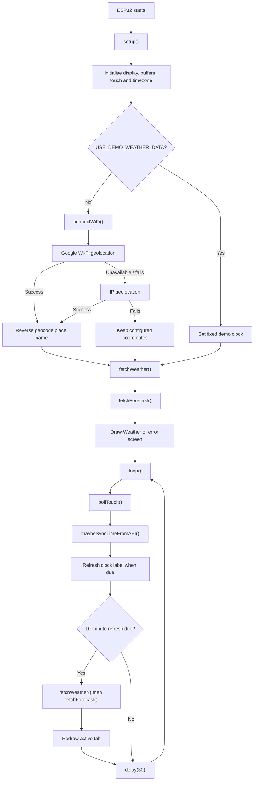
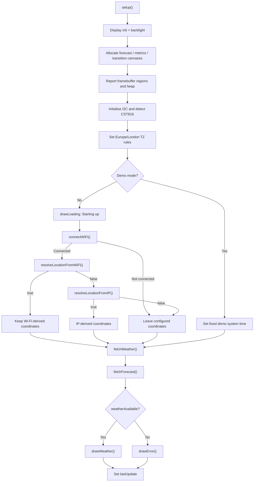
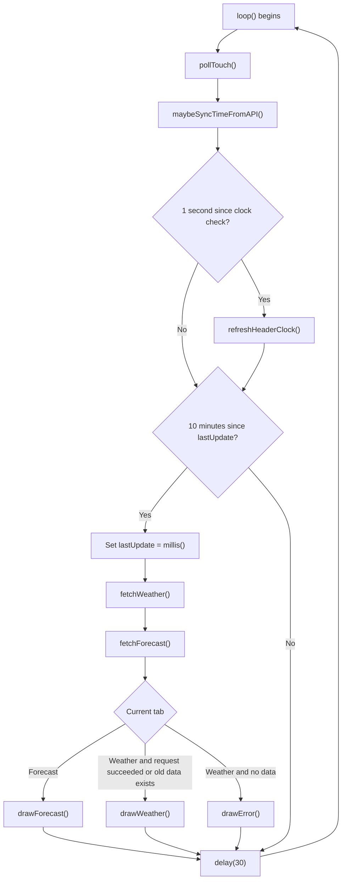
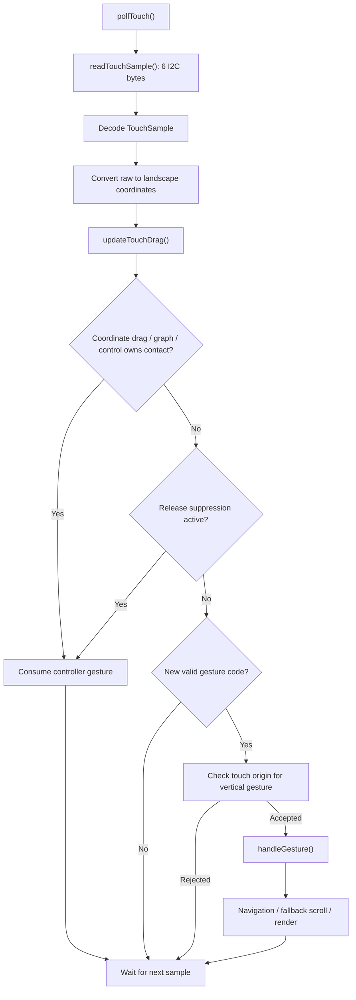
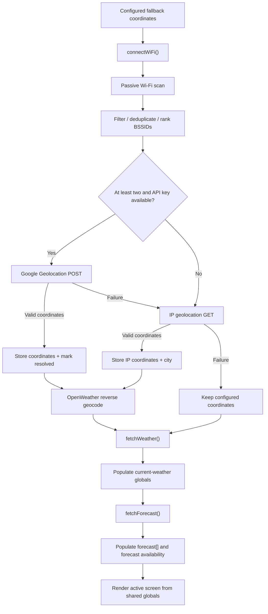

# Phase 0, Step 2 — Runtime data-flow map

**Status:** Complete — static runtime / call-flow trace  
**Roadmap:** [Platform Refactor Roadmap](../PLATFORM_REFACTOR_ROADMAP.md)  
**Related inventory:** [Phase 0, Step 1 — Code inventory](PHASE0_STEP1_CODE_INVENTORY.md)  
**Repository:** `mdrmx/esp32-gadget`  
**Source file:** `weatherDashboard.ino`  
**Source branch:** `main`  
**Source commit inspected:** `9721eb688c7b96ecb55e7ee00c61096e08c8fd5f`  
**Source blob:** `02ba63e385a36eb64d542df644126e7efea0b8b4`  
**Review date:** 2026-10-31

---

## 1. Scope and method

This document completes Phase 0, Step 2: trace how the existing firmware behaves at runtime and how input, application state, network responses and rendering connect.

The trace follows the complete current `weatherDashboard.ino` from `main`, including the startup sequence, repeating `loop()`, touch sample decoding, drag ownership, gesture dispatch, screen rendering, network requests, location resolution and time synchronisation.

This is a **static source-level runtime map**. It does not claim that the firmware was compiled, profiled, or tested on the physical Waveshare board during this step. Timing values below are configured timeout / scheduling values in the source, not measured network latency or observed responsiveness.

### Snapshot

| Item | Observed |
|---|---:|
| Sketch size | 3,594 lines |
| Current source blob | `02ba63e385a36eb64d542df644126e7efea0b8b4` |
| Main entry points | `setup()` and `loop()` |
| Main display tabs | Current Weather and Hourly Forecast |
| Weather refresh interval | 600,000 ms (10 minutes) |
| Loop idle delay | 30 ms |
| Clock header check | 1 second |
| Time API resynchronisation | 6 hours |
| Time API retry interval | 5 minutes |
| Forecast storage capacity | 48 records |
| Forecast list page | 3 records |
| Forecast graph viewport | 6 points |
| Canvas buffers | 3, allocated in `setup()` |

The Step 1 inventory records the complete function and global-state inventory. This document focuses on how those functions call one another and how the shared global state moves between them.

## 2. Runtime architecture at a glance

There is no application manager or platform service layer in the current sketch. The Arduino setup / loop model is the top-level scheduler. The Weather dashboard owns the device-wide display, touch, network and time paths directly.

The main global state groups and their current responsibilities are:

| State group | Representative globals | Current role |
|---|---|---|
| Connectivity / credentials | `wifiSsid`, `wifiPassword`, `apiKey` | Compile-time credentials and OpenWeather API key |
| Location | `locationLat`, `locationLon`, `locationDisplayName`, `locationCoordinatesResolved` | Coordinates and preferred display name used by Weather |
| Time | `timeApiValid`, `lastTimeApiAttemptMs`, `lastTimeApiSyncMs`, `locationTimezoneOffset` | System clock sync scheduling and provider-local forecast time |
| Current weather | `temperature`, `feelsLike`, `humidity`, `weatherDescription`, `weatherIcon`, `weatherAvailable` | Current Weather screen and metric-card content |
| Forecast | `forecast[]`, `forecastCount`, `forecastAvailable`, `forecastError` | Fixed-capacity hourly data store and availability state |
| Navigation / presentation | `currentTab`, `forecastGraphView`, `weatherMetricOffset`, `forecastOffset`, `forecastGraphScrollPixels` | Active view and scroll positions |
| Touch interaction | metric, forecast and graph candidate / active / suppression globals | Ownership, axis intent, drag positions, release and duplicate-gesture suppression |
| Display | `gfx`, three canvas pointers, `screenW`, `screenH` | Physical display access, off-screen rendering and transition composition |

These groups are all held in file-scope variables. Their current ownership is therefore implicit: multiple functions can read or mutate the same values.

## 3. Startup sequence — `setup()`

The live startup path is ordered and synchronous.

1. **Serial and display startup (lines 3424–3442).** Serial starts at 115200 baud. The sketch calls `gfx->begin()`. A failed display initialisation enters an infinite one-second delay loop. On success, the backlight is enabled and logical display dimensions are read from `gfx`.
2. **Canvas allocation (lines 3443–3505).** The forecast viewport canvas, weather-metrics canvas and full-screen tab-transition canvas are allocated in that order. Each allocation is checked; a failed canvas is deleted and its pointer set to `nullptr`. The corresponding renderer has a direct-render or instant-transition fallback.
3. **Memory diagnostics (lines 3508–3521).** The sketch inspects each framebuffer pointer to report whether it is in external RAM, then logs PSRAM and internal heap summaries. The code does not assume that Arduino_GFX placed these buffers in PSRAM.
4. **Touch-controller detection (lines 3524–3529).** I²C starts on the configured touch pins at 100 kHz. A transmission to the CST816 address determines `touchAvailable`. If the controller is not detected, display and network startup continue, but `pollTouch()` returns immediately on every loop.
5. **Timezone configuration (line 3531).** `initialiseTimeZone()` installs the UK timezone / daylight-saving rule string and calls `tzset()`. This configures local-time conversion; it does not itself obtain a valid system time.
6. **Demo or live startup (lines 3533–3559).**
   - In demo mode, the system clock is set to the fixed development timestamp in the sketch. No initial Wi-Fi or location requests are made.
   - In live mode, the screen displays a startup loading message and calls `connectWiFi()`. If it connects, the sketch tries Google Wi-Fi positioning first. If that returns false, it tries IP geolocation. The configured Manchester coordinates remain the initial fallback if both location providers fail.
7. **Weather data retrieval (lines 3561–3562).** `fetchWeather()` runs, followed by `fetchForecast()`. Both return data availability through shared globals and return values. The forecast request is still attempted if current-weather retrieval fails.
8. **Initial screen and refresh timer (lines 3564–3567).** If `weatherAvailable` is true, `drawWeather()` displays the current conditions. Otherwise `drawError()` displays the Weather unavailable state. `lastUpdate` is then set to the current `millis()` value.

### Startup flow detail

### Important startup nuance

`connectWiFi()` may itself call `maybeSyncTimeFromAPI()` once a connection is available. The first TimeAPI request can therefore happen inside the startup connection path, before location resolution. The later `fetchWeather()` and `fetchForecast()` calls each invoke `connectWiFi()` again; when Wi-Fi is already connected this is a status check plus a time-sync check, not another `WiFi.begin()` association attempt.

If the initial connection attempt fails, the live startup path still calls `fetchWeather()` and `fetchForecast()`. Each of those functions calls `connectWiFi()` again, so the sketch can make further connection attempts rather than stopping after the first startup failure.

## 4. Main loop and scheduling

The complete `loop()` body is small (lines 3573–3594), but it runs several potentially blocking operations in sequence.

| Activity | Trigger / cadence | Behaviour |
|---|---|---|
| Touch polling | Every loop pass | Read and interpret one CST816 sample when touch is available |
| Time sync check | Every loop pass | Check Wi-Fi state and determine whether a TimeAPI request is due |
| Header clock | At least once per second | Re-read the system clock; redraw only if the displayed minute string changed |
| Weather refresh | Every 600,000 ms | Fetch current conditions, then hourly forecast, then redraw the active tab |
| Idle pacing | Every loop pass | `delay(30)` after the work above |

The 10-minute interval is `UPDATE_INTERVAL = 600000UL`. `lastUpdate` is assigned **before** the two fetch operations begin. If a refresh takes long enough to cross another interval boundary, the next loop pass can find the refresh due again; there is no separate refresh-complete timestamp.

The loop is not a fixed-rate real-time scheduler. The nominal 30 ms delay is reached only after touch processing, time checks, rendering and any network activity have returned.

## 5. Touch and interaction data flow

### 5.1 Hardware sample to logical screen coordinates

`pollTouch()` is the touch entry point and calls `readTouchSample()`. The reader selects the CST816 gesture register and reads six bytes in one I²C transaction. The bytes become the `TouchSample` fields:

- `gesture` — controller gesture code.
- `fingerCount` — low nibble of the finger-count register.
- `event` — top two bits of the event register (0 down, 1 up, 2 contact).
- `rawX` and `rawY` — 12-bit coordinate values assembled from register nibbles and bytes.

The panel reports coordinates in its portrait-native frame, while the display is used in landscape. `touchCoordinatesToScreen()` maps them as:

- `screenX = rawY`
- `screenY = screenH - 1 - rawX`

Both values are constrained to the logical display bounds.

A touch is treated as present when `fingerCount > 0` and `event != 1`. Touch-up coordinates are deliberately ignored. Failed or incomplete I²C reads do not create a new sample; `pollTouch()` returns without dispatching a gesture.

### 5.2 Touch ownership and gesture arbitration

The important sequence is:

1. `pollTouch()` obtains the sample and records raw gesture-register transitions for diagnostics.
2. `updateTouchDrag()` processes coordinate movement, touch-down origin, candidate states, drag states, release/snap behaviour and control taps.
3. Back in `pollTouch()`, the controller gesture code is checked against active touch ownership and suppression windows. If an in-progress drag, graph-owned contact, selector press or release suppression owns the interaction, the controller gesture is consumed.
4. A zero gesture clears the duplicate-gesture latch. A non-zero, changed gesture within the configured CST816 gesture-code range is passed to origin checks and then `handleGesture()`.
5. `handleGesture()` applies a 250 ms rate limit and maps the accepted controller code to navigation or legacy scrolling.

This arbitration exists because a single physical contact can produce both coordinate movement and a completed CST816 gesture. Without suppression, one drag could be applied twice.

### 5.3 Current-weather metric cards

Coordinate-tracked metric dragging is enabled only when the touch starts in the metrics panel, the current tab is Weather, and `weatherMetricsCanvas` is available.

- A touch-down creates a candidate; it does not immediately claim the gesture.
- Movement of at least 8 px on the horizontal axis, greater than vertical movement, resolves as a horizontal swipe and returns control to normal tab gesture handling.
- Movement of at least 8 px vertically, with vertical movement at least as large as horizontal movement, activates the coordinate-tracked metric drag.
- The scroll position follows the inverse finger Y delta, with resisted overscroll capped by the shared 20 px limit.
- On release, the scroll position is rounded to the nearest metric row and snapped. The completed controller gesture is suppressed for 300 ms.

If the metrics canvas is unavailable, coordinate-tracked metric dragging is not started. The older gesture-only fallback remains available, but vertical gesture origin is still required to be inside the metrics panel.

The metrics viewport renders through `weatherMetricsCanvas` when available and when not composing a tab transition. Otherwise the same metric-item renderer draws directly to `gfx` with clipping.

### 5.4 Forecast list

Coordinate-tracked list dragging requires all of the following at touch-down:

- Forecast tab active and List mode selected.
- Forecast canvas allocated.
- Forecast data available with more than the three visible entries.
- Touch begins inside the forecast viewport, away from the outer horizontal edges.
- No forecast selector press has claimed the contact.

The candidate uses the same 8 px axis-intent threshold as metric scrolling. Vertical movement activates the drag; horizontal movement releases the candidate so the normal tab swipe can be handled.

The scroll follows the finger's Y delta with elastic overscroll. The display redraw is rate-limited to `FORECAST_DRAG_RENDER_INTERVAL_MS` (50 ms), and the deadline is checked even when the finger stops moving. On release, the list snaps to the nearest valid row and suppresses the controller's duplicate gesture for 300 ms.

If the canvas is unavailable or the other candidate requirements are not met, the gesture-only fallback can still scroll the list, gated by the touch origin being inside the list viewport.

### 5.5 Forecast graph

Graph interaction has a different ownership model because horizontal movement is used both for graph panning and for returning to the Weather tab.

- A touch starting in the graph body (below the selector strip and within the forecast viewport) is owned by the graph until release, even if coordinate tracking drops temporarily.
- A clear horizontal movement of at least 55 px before the 220 ms hold threshold is treated as a quick tab swipe. A rightward movement returns from Forecast to Weather.
- Otherwise, after the 220 ms hold delay, horizontal movement of at least 4 px activates graph dragging. The graph scroll follows the finger horizontally with the same elastic-scroll helper and 50 ms render throttling.
- A strong vertical movement of at least 20 px before the hold threshold cancels graph panning, but the contact remains graph-owned so a lost coordinate sample cannot fall through into an unintended tab gesture.
- On release after a graph drag, the scroll snaps to the nearest 56 px hourly point.
- After any graph-owned release, the CST816 controller gesture remains suppressed until the gesture register has returned to zero for the required quiet interval. A new touch-down explicitly begins a new interaction sequence and clears the previous latch.

The standard controller vertical gestures are ignored in graph mode. Graph panning is coordinate-tracked; the legacy vertical forecast gesture path does not apply there.

### 5.6 Forecast selector

The selector records a control press when touch-down is in its hit region and within the List / Graph segments. Movement exceeding the 40 px tap slop cancels the selector press so a deliberate swipe can still be interpreted by the normal gesture path.

On release, control 3 selects List and control 4 selects Graph. `handleForecastControlTap()` resets both list and graph scroll positions to the beginning, changes `forecastGraphView`, redraws the forecast screen and suppresses the resulting controller gesture.

### 5.7 Legacy gesture mappings

After touch-origin and suppression checks, `handleGesture()` handles the remaining controller codes:

| Raw controller code | Current Weather tab | Forecast tab |
|---|---|---|
| `GESTURE_SCREEN_RIGHT` | Opens Forecast | No tab change |
| `GESTURE_SCREEN_LEFT` | No tab change | Returns to Weather |
| `GESTURE_SCREEN_UP` | Advances metric cards | Advances forecast list by one row; ignored in graph mode |
| `GESTURE_SCREEN_DOWN` | Moves metric cards backward | Moves forecast list backward; ignored in graph mode |

The comments in the code describe these as provisional physical-direction mappings. The mapping above records the raw code-to-action behaviour, rather than assuming every panel reports physical direction identically.

## 6. Rendering and display data flow

Rendering is initiated directly by the startup path, refresh path, touch handlers, gesture handlers and selector tap handler. There is no separate render queue or application view interface.

### 6.1 Current Weather

`drawWeather()` sets `currentTab` to Weather, clears the display, draws the header, then renders:

1. Weather icon.
2. Wrapped condition description.
3. Temperature.
4. Feels-like temperature.
5. Weather metric-card viewport.
6. Tab indicator.

The displayed values are read from the global current-weather fields populated by `fetchWeather()` and `fetchForecast()`.

**Important side effect:** the icon path is not purely a renderer. `drawWeather()` calls `drawOpenWeatherIcon()`, which calls `loadOpenWeatherIconPNG()`. If the single-entry icon cache does not contain the current `weatherIcon` code, that function performs an HTTPS GET to download the PNG. The response is allocated into a heap buffer, validated, cached by icon code and later decoded by PNGdec. The PNG line callback draws through the current global `gfx` pointer.

Consequently, drawing the Weather screen can initiate network I/O and block the caller. A tab transition that composes the Weather screen can also encounter this path if the icon is not already cached.

### 6.2 Weather metric viewport

`drawWeatherMetricsViewport()` renders the visible metrics and neighbouring partial cards to preserve smooth movement. It uses `weatherMetricsCanvas` and flushes the panel when possible. During transition composition or when the canvas is unavailable, it clears and draws the panel directly through `gfx`.

Scrolling state is held in `weatherMetricOffset` plus transient pixel positions used during drag and snap. The renderer reads the global weather values through the metric label/value helpers; it does not receive a standalone weather model object.

### 6.3 Forecast viewport — List and Graph

`drawForecast()` sets `currentTab` to Forecast, clears the screen and draws the header. If no hourly data is available, it shows `forecastError` (or a generic no-data message), then draws the selector and footer.

When data is available, `drawForecastViewport()` renders the viewport:

- In List mode, forecast entries are read from `forecast[]` and drawn through the clipping item renderer.
- In Graph mode, `drawForecastGraph()` draws the temperature line, hourly points, precipitation bars and associated labels.
- With `forecastCanvas` available and not composing a tab transition, the viewport is drawn off-screen and flushed as a bitmap.
- If the canvas is unavailable, the renderer clears and draws directly to `gfx`.

The graph maintains a continuous pixel scroll position (with a corresponding hourly offset), while list mode uses row offset plus within-row pixels.

### 6.4 Tab transition composition

`animateTabTransition()` resets all scroll positions, swaps the global `gfx` pointer to `tabTransitionCanvas` temporarily, and calls the destination screen renderer to compose an off-screen full-screen frame. It then restores the live display pointer and slides the central content area across the physical display over eight frames with a 9 ms delay per intermediate frame.

If the transition canvas or its framebuffer is unavailable, the destination screen is drawn directly with no animated transition.

This is another example of implicit display ownership: screen renderers do not receive a display target consistently; they normally use the global `gfx` pointer, which the transition function temporarily redirects.

## 7. Network, location and weather data flows

### 7.1 Connectivity

`connectWiFi()` is the only connection-establishment helper, but it is not a platform-independent connectivity service.

- If `WiFi.status()` is already connected, it checks time synchronisation and returns true.
- Otherwise it draws a Wi-Fi loading message, switches to station mode, calls `WiFi.begin(wifiSsid, wifiPassword)` and polls connection status for up to 20 seconds, sleeping 500 ms between checks.
- On success it logs the IP address, checks time synchronisation and returns true.
- On timeout it returns false.

Credentials are still read from compile-time values supplied by the ignored `secrets.h`. The sketch has no Preferences / NVS network profile store, no network-selection UI and no alternate network backend.

### 7.2 Location resolution

The live startup location chain is:

1. Start with the configured default coordinates: latitude 53.4808, longitude -2.2426. `locationCoordinatesResolved` is initially false.
2. If the Google Geolocation API key is compiled in, `resolveLocationFromWiFi()` passively scans nearby access points. It filters the scan results, deduplicates eligible BSSIDs, sorts by signal strength and retains up to 15. At least two usable access points are required.
3. The request sends `considerIp: false` and the access-point BSSID, signal strength, channel and age values to Google. No connection to those nearby networks is made.
4. Valid returned coordinates are range-checked, stored in `locationLat` / `locationLon` and marked resolved. A returned accuracy radius is logged when present. The function then attempts OpenWeather reverse geocoding to obtain a display name.
5. If the Wi-Fi positioning function returns false (missing key, inadequate scan, request error or invalid response), startup calls `resolveLocationFromIP()`. It requests `https://ipwho.is/`, validates the coordinates, stores them and retains the provider city as an initial display-name fallback. It then attempts OpenWeather reverse geocoding.
6. If both providers fail, the configured coordinates remain in use. The current-weather response can supply its coordinates only while `locationCoordinatesResolved` is false.

OpenWeather reverse geocoding uses the resolved latitude / longitude and `limit=1`. A valid returned place name updates `locationDisplayName`; failure leaves the prior fallback name intact.

The header prefers `locationDisplayName`, then `weatherCity`, then the configured `CITY` value. The current-weather provider's city name and the location display name are deliberately kept separate because the weather station name may refer to a nearby reporting location.

### 7.3 Current weather request

`fetchWeather()` loads the local fixture immediately in demo mode. In live mode it:

1. Calls `connectWiFi()`; if this fails, it displays stale Weather data when available or a Wi-Fi error when no data exists.
2. Displays a loading message.
3. GETs OpenWeather current conditions using the stored latitude / longitude, API key and metric units.
4. Parses the response and updates current-weather globals: place / condition / icon, temperature, feels-like, humidity, pressure, wind speed, cloud cover, visibility and rainfall.
5. Updates `locationTimezoneOffset` from the response. If location was not resolved earlier, it may adopt the coordinates supplied by the current-weather response.
6. Sets `weatherAvailable` true when parsing succeeds.

The response wind speed is converted from metres per second to kilometres per hour before it is stored in `windSpeedKmh`.

### 7.4 Hourly forecast request

`fetchForecast()` also bypasses the network in demo mode. In live mode it:

1. Calls `connectWiFi()`.
2. Resets forecast count, error text and the current UV / precipitation-probability availability flags.
3. Requests the OpenWeather One Call 4.0 one-hour timeline endpoint.
4. Follows the response's `next` URL for up to three pages, stopping at the 48-record capacity, an empty next URL or a page failure.
5. Deduplicates records by timestamp and stores each valid entry in the fixed `forecast[]` array.
6. Updates the current UV index and current precipitation probability from the first valid hourly record when those values are supplied.
7. Updates `locationTimezoneOffset` from the One Call response and calculates the list / graph scroll bounds after retrieval.
8. Sets `forecastAvailable` according to whether at least one valid record was stored. Failure reason is retained in `forecastError`.

The list displays up to three records at once. The graph uses six visible hourly points, spaced 56 px apart.

### Location and weather flow

## 8. Time and forecast timezone flow

There are two distinct time concepts in the current sketch.

### Device clock / header time

- `initialiseTimeZone()` configures the device for Europe/London time, including UK daylight-saving rules.
- `fetchTimeFromAPI()` requests the current local date/time from TimeAPI.io when synchronisation is due. It validates the returned fields, converts the London wall-clock time to an epoch using `mktime()` and sets the ESP32 system clock using `settimeofday()`.
- `maybeSyncTimeFromAPI()` checks once per loop whether a sync is due. Before the first valid sync, it retries no more often than every five minutes. After a successful sync, the normal resynchronisation interval is six hours; a failed due sync is retried no more often than every five minutes.
- `getHeaderClockText()` reads the system epoch and converts it with `localtime_r()`. It returns `--:--` if the system time is not valid.
- `refreshHeaderClock()` runs on the one-second loop check, but redraws the clock region only when the displayed text changes.

### Forecast time labels

Hourly timestamps are formatted using `locationTimezoneOffset` from the OpenWeather response, with UTC conversion after applying that offset. This is separate from the Europe/London timezone configured for the system header clock. A device located outside the UK can therefore display forecast-local times while the header remains in the device's configured UK timezone.

## 9. Blocking operations and responsiveness

The current implementation runs touch processing, time synchronisation, network requests and rendering sequentially on the Arduino loop / call stack. The sketch does not define an asynchronous request queue or a dedicated application-level network task.

The following are source-configured bounds / timeouts. They are not guarantees of total operation duration, and nested calls can make a complete startup or refresh much longer.

| Operation | Source-configured wait / timeout |
|---|---:|
| Wi-Fi association in `connectWiFi()` | Up to 20 s; 500 ms polling delay |
| TimeAPI.io request | 5 s connect timeout and 5 s request timeout |
| Google Geolocation request | 10 s connect timeout and 12 s request timeout |
| IP geolocation request | 8 s connect timeout and 8 s request timeout |
| OpenWeather reverse geocoding | 8 s connect timeout and 8 s request timeout |
| OpenWeather current weather | 15 s connect timeout and 15 s request timeout |
| OpenWeather One Call page | 15 s connect timeout and 15 s request timeout per page; up to 3 pages |
| OpenWeather icon download | 10 s connect timeout and 10 s HTTP timeout; manual body-read deadline up to 8 s |

The icon loader also allocates a heap buffer sized from the HTTP content length (accepted range: greater than 8 and no more than 20,000 bytes). It waits for all expected bytes, validates the PNG signature and replaces the previous cached icon buffer after a successful download.

Other intentional blocking work includes:

- The seven-frame metric scroll animation (8 ms delay per frame).
- The six-frame metric snap animation (8 ms delay per frame).
- Forecast and graph snap / scroll rendering.
- The eight-frame tab transition (9 ms delay on intermediate frames).
- The 30 ms delay at the end of every loop pass.

### Consequences for the platform refactor

- A time-sync check inside `loop()` can perform HTTPS work and delay subsequent touch samples.
- A Weather refresh performs current conditions and forecast retrieval serially. The forecast may require multiple paginated HTTP requests.
- `drawWeather()` can download an icon on a cache miss. Rendering is therefore capable of invoking network and heap allocation work.
- `connectWiFi()` draws UI as a side effect, while fetch functions also draw loading / error / stale-data states. Network and presentation responsibilities are mixed.
- Touch handlers call renderers and animation functions directly; some of those paths include explicit delays.
- The loop's 30 ms delay does not bound touch latency because the work before it is not time-bounded by the loop itself.

These are source-level reasons to investigate a queued / state-driven network service and a predictable update/render schedule before the platform adds more apps. Phase 0 still needs actual responsiveness measurements on the device.

## 10. Current external request map

| Purpose | Function | Provider / endpoint | Method |
|---|---|---|---|
| System time | `fetchTimeFromAPI()` | TimeAPI.io, Europe/London current time | GET |
| Weather condition icon | `loadOpenWeatherIconPNG()` | OpenWeather icon PNG URL | GET |
| Location place name | `resolveLocationNameFromCoordinates()` | OpenWeather reverse geocoding v1.0 | GET |
| Wi-Fi positioning | `resolveLocationFromWiFi()` | Google Geolocation API | POST |
| IP positioning | `resolveLocationFromIP()` | ipwho.is | GET |
| Current conditions | `fetchWeather()` | OpenWeather current weather 2.5 | GET |
| Hourly forecast | `fetchOneCallForecastPage()` via `fetchForecast()` | OpenWeather One Call 4.0 timeline | GET |

All these clients currently use `WiFiClientSecure` and call `setInsecure()`. Certificate validation is therefore not being enforced by these HTTPS call sites. This is a known security concern recorded in the roadmap; this Step 2 document records the current behaviour and does not change it.

The APIs are called directly by Weather-sketch functions. There is no shared HTTP request service, connectivity abstraction or location-provider interface in the current implementation.

## 11. Data ownership and coupling findings

The runtime trace makes the following dependencies explicit:

| Current relationship | Why it matters to the refactor |
|---|---|
| `setup()` owns display, canvas, touch and time initialisation | These are device/platform responsibilities and should not remain hidden in a Weather app entry point forever |
| `loop()` schedules input, time, clock and Weather refresh | A future Application Manager will need a deliberate update cadence and app lifecycle |
| Weather fetch functions own Wi-Fi checks and HTTP clients | Weather data retrieval is coupled to one transport implementation |
| Location functions write global coordinates and display-name fields | Location is a platform capability, but currently has no fix object, source/freshness metadata or service boundary |
| Time API and header functions own system-clock updates | The clock is device-wide, while forecast time formatting also uses provider-local offset state |
| Screen renderers read global weather / forecast state | View code cannot be cleanly reused with independent app data models |
| Weather rendering can fetch an icon | Rendering has a network side effect and may block |
| Touch functions mutate scroll state and call renderers | Input recognition, interaction state and view rendering are tightly coupled |
| Tab transition temporarily swaps global `gfx` | Render target ownership is implicit and globally mutable |
| All operations share one sequential call stack | Slow network or animation work delays input and other application work |

### Candidate boundaries exposed by this trace

These are responsibilities visible in the existing code, not a final class or filename decision:

1. **Display / graphics owner:** display initialisation, logical size, framebuffer allocation, canvas lifetime and a stable render target.
2. **Touch input reader:** CST816 register access and raw sample decoding.
3. **Gesture recogniser / interaction controllers:** axis intent, touch ownership, tap / swipe / drag classification and duplicate-event suppression.
4. **Scroll controller:** scroll position, bounds, overscroll, snap and render scheduling, while keeping screen-specific content rendering outside the controller.
5. **Connectivity manager:** network interface state and reconnect policy, without drawing loading screens.
6. **HTTP / request support:** transport, timeout, TLS validation and request completion / error representation.
7. **Location service:** provider selection and a location result that can retain source, accuracy and freshness.
8. **Time service:** system-clock initialisation, synchronisation policy, timezone handling and clock validity.
9. **Weather data service / model:** current and hourly data retrieval and storage separate from screen rendering.
10. **Application / view layer:** active-screen lifecycle and screen-specific rendering, without owning device connectivity.

The exact interfaces remain subject to the remaining Phase 0 audit and the Arduino build/toolchain constraints.

## 12. Audit notes and unresolved items

### Confirmed by this source trace

- The runtime is driven by `setup()` and a sequential `loop()`.
- Weather, forecast, location, clock and icon requests are synchronous at sketch level.
- Startup performs location resolution before the first current-weather and forecast retrieval in live mode.
- Google Wi-Fi positioning is preferred, IP positioning is the fallback, and configured coordinates are the final fallback.
- Touch processing includes several distinct coordinate-driven interaction modes plus controller gesture fallbacks.
- Weather and forecast rendering read global data and interact with global display/canvas state.
- The current Weather screen's icon rendering path can initiate a network request.
- There is no persistent Wi-Fi profile manager, shared connectivity layer or application manager in the current sketch.

### Documentation discrepancy — resolved

The source defines `USE_DEMO_WEATHER_DATA` as `0` (live mode). `DEVELOPMENT_MODE.md` has been corrected to describe live mode as the current default and `1` as the opt-in offline demo setting. No firmware setting was changed to resolve this documentation mismatch.

### Not established by this static trace

- Actual touch-to-render latency under normal use or during network requests.
- Real startup / refresh duration under good and poor Wi-Fi conditions.
- Actual free-heap / largest-block changes over repeated icon replacement and forecast refresh.
- Whether canvas memory is in PSRAM on the user's current board and build.
- Whether all documented Arduino IDE / board-package / library versions compile this exact source.
- Whether the current hardware behaviour matches every edge-case path described by the state machine.
- Whether any library internals use additional tasks or asynchronous behaviour; this map describes the explicit sketch-level call flow.

## 13. Remaining Phase 0 work and next action

The map remains the behavioural reference for the remaining baseline work. Current status, in sequence:

1. [x] **Build/toolchain verification:** exact Waveshare board selection, ESP32 Arduino core, IDE/compiler/library versions, FQBN and successful physical build/upload are recorded in [Step 3](PHASE0_STEP3_BUILD_TOOLCHAIN.md).
2. [x] **Blocking-operation review and initial physical baseline:** synchronous network paths and initial startup/idle/weather/forecast/full-refresh measurements are recorded in [Step 4](PHASE0_STEP4_BLOCKING_RESPONSIVENESS_AUDIT.md). Additional fault-path, animation and cache-miss checks remain useful follow-up validation, not a reason to discard the baseline.
3. [ ] **Memory baseline — next:** capture PSRAM capacity/free space, internal 8-bit heap free space, largest internal free block, minimum-ever free heap where available, and the actual allocation region/size of each canvas. Take comparable snapshots after canvas setup, after startup network/data loading, after repeated weather/forecast refreshes, and after an icon change/cache miss. See the current handover in [the Platform Refactor Roadmap](../PLATFORM_REFACTOR_ROADMAP.md) for the diagnostic caveat and intended procedure.
4. [x] **Demo-mode documentation reconciliation:** `DEVELOPMENT_MODE.md` now matches the live firmware default (`USE_DEMO_WEATHER_DATA 0`).
5. [ ] **Documentation and regression procedure:** check the remaining setup guides against current source and turn Weather, forecast list/graph, touch, clock, location and network behaviour into a reproducible hardware regression checklist.
6. [ ] **Module boundary plan:** combine this map with the Step 1 inventory, Step 3 toolchain constraints, Step 4 findings and measured memory headroom to settle the first extraction boundaries.

Do not begin broad source extraction until the memory baseline, documentation/regression review and module-boundary plan are complete. The remaining evidence is needed to avoid choosing file boundaries or interfaces that conflict with the actual toolchain, memory constraints or observed device behaviour.

## 14. Change history

- **2026-10-31 — Version 1.0:** Initial Step 2 runtime trace. Documents startup, loop scheduling, touch ownership and gesture arbitration, rendering paths, network / location / time flows, blocking operations and candidate platform boundaries. Static source inspection only.
- **2026-11-01 — Version 1.1:** Updated remaining-work guidance after the Step 4 physical baseline; marked build/toolchain and initial blocking-operation verification complete, clarified that memory profiling is the next Phase 0 activity, and recorded the demo-mode documentation discrepancy as resolved.
