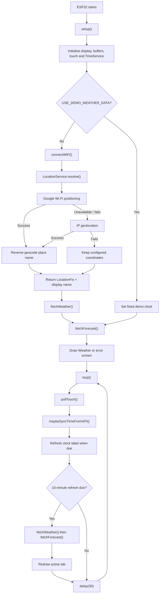
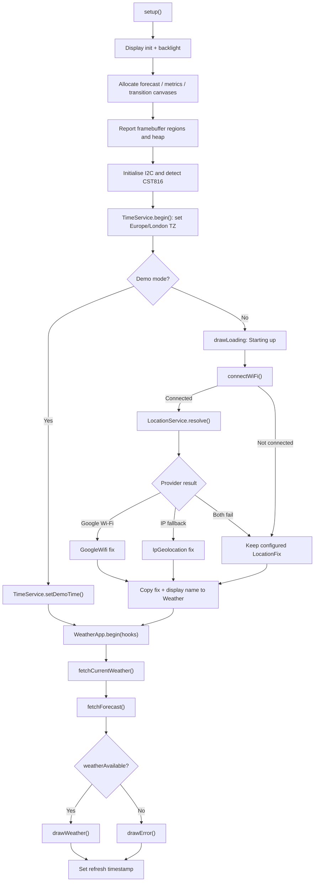
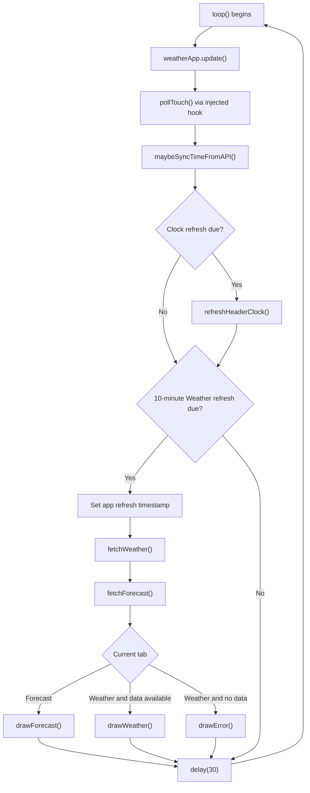
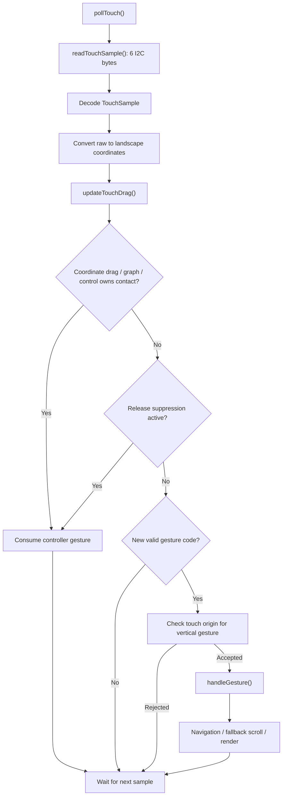
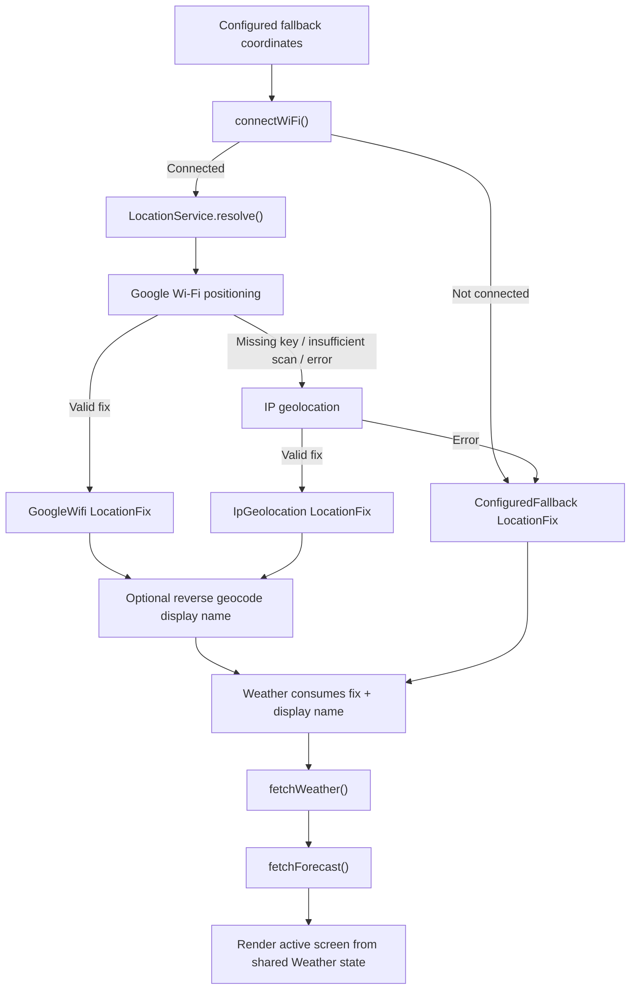

# Phase 0, Step 2 — Runtime data-flow map

**Status:** Complete — static runtime / call-flow trace  
**Roadmap:** [Platform Refactor Roadmap](../PLATFORM_REFACTOR_ROADMAP.md)  
**Related inventory:** [Phase 0, Step 1 — Code inventory](PHASE0_STEP1_CODE_INVENTORY.md)  
**Repository:** `mdrmx/esp32-gadget`  
**Primary runtime entry point:** `weatherDashboard.ino`  
**Service/application modules:** `src/services/HttpRequestClient.h`, `src/services/TimeService.h`, `src/services/LocationService.h`, `src/services/WeatherDataService.h`, `src/apps/weather/WeatherApp.h` and `src/apps/weather/WeatherViewState.h`  
**Source checkpoint:** branch `phase1/14-weather-view-state` based on PR #39 merge `3c613363f3b57bebe4245350cc57a3d6aa7a52d6`  
**Extraction status:** PRs #37–#39 are merged and validated. PR #39 WeatherApp shell is hardware-validated. PR #40 moves persistent tab, metric/list/graph offset and forecast-mode state into WeatherViewState; its C++11 host tests pass. Arduino IDE Verify, upload/boot and Waveshare physical regression for PR #40 remain pending. Renderer and detailed touch-policy ownership remain in the sketch.  
**Review date:** 2026-11-13

---

## 1. Scope and method

This document completes Phase 0, Step 2: trace how the existing firmware behaves at runtime and how input, application state, network responses and rendering connect.

The trace follows the merged Weather sketch and extracted services after PR #36, plus the PR #37 request-transport migration on the current feature branch. It covers startup, repeating `loop()`, touch sample decoding, drag ownership, gesture dispatch, screen rendering, network requests, location resolution and time synchronisation.

This is a **static source-level runtime map**. It does not claim that the firmware was compiled, profiled, or tested on the physical Waveshare board during this step. Timing values below are configured timeout / scheduling values in the source, not measured network latency or observed responsiveness.

### Snapshot

| Item | Observed |
|---|---:|
| Sketch size | 47 lines |
| Current source blob | `1cd98bd7575854bb2f796b70b9ed5cb451da578e` |
| Main entry points | `setup()` and `loop()` |
| Main display tabs | Current Weather and Hourly Forecast |
| Weather refresh interval | 600,000 ms (10 minutes) |
| Loop idle delay | 30 ms |
| Clock header check | 1 second |
| Time API resynchronisation | 6 hours |
| Time API retry interval | 5 minutes |
| Forecast storage capacity | 48 records |
| Forecast list page | 3 records |
| Forecast graph viewport | 6 points |
| Canvas buffers | 3, allocated in `setup()` |

The Step 1 inventory records the complete function and global-state inventory. This document focuses on how those functions call one another and how the shared global state moves between them.

## 2. Runtime architecture at a glance

There is no application manager or platform service layer in the current sketch. The Arduino setup / loop model is the top-level scheduler. The Weather dashboard owns the device-wide display, touch, network and time paths directly.

The main global state groups and their current responsibilities are:

| State group | Representative globals | Current role |
|---|---|---|
| Connectivity / credentials | `wifiSsid`, `wifiPassword`, `apiKey` | Compile-time credentials and OpenWeather API key |
| Location | `LocationService::LocationFix`, `currentLocationFix`, plus Weather's `locationLat`, `locationLon`, `locationDisplayName`, `locationCoordinatesResolved` | Provider/source/accuracy/observation/validity result, plus existing Weather-facing coordinates and preferred display name |
| Time | `TimeService`, Weather's header redraw cache, `locationTimezoneOffset` | Device clock validity/synchronisation and UK civil time; provider-local forecast offset remains separate |
| Current weather | `temperature`, `feelsLike`, `humidity`, `weatherDescription`, `weatherIcon`, `weatherAvailable` | Current Weather screen and metric-card content |
| Forecast | `forecast[]`, `forecastCount`, `forecastAvailable`, `forecastError` | Fixed-capacity hourly data store and availability state |
| Navigation / presentation | `currentTab`, `forecastGraphView`, `weatherMetricOffset`, `forecastOffset`, `forecastGraphScrollPixels` | Active view and scroll positions |
| Touch interaction | metric, forecast and graph candidate / active / suppression globals | Ownership, axis intent, drag positions, release and duplicate-gesture suppression |
| Display | `gfx`, three canvas pointers, `screenW`, `screenH` | Physical display access, off-screen rendering and transition composition |

These groups are all held in file-scope variables. Their current ownership is therefore implicit: multiple functions can read or mutate the same values.

## 3. Startup sequence — `setup()`

The live startup path is ordered and synchronous.

1. **Serial, display and canvas startup.** Serial starts, the display is initialised, logical dimensions are read and the forecast, weather-metrics and tab-transition canvases are allocated with their existing fallback behaviour.
2. **Memory diagnostics.** The sketch reports framebuffer memory regions plus PSRAM and internal-heap summaries.
3. **Touch-controller detection.** The CST816 reader initialises the touch interface. If the controller is unavailable, display and network startup continue while touch polling returns immediately.
4. **Time service setup.** `timeService.begin()` configures the Europe/London timezone/DST rule. This does not itself establish a valid clock. The existing `maybeSyncTimeFromAPI()` caller delegates synchronisation and retry policy to `TimeService::syncIfDue()`.
5. **Demo or live startup.** In demo mode, `TimeService::setDemoTime()` sets the fixed development timestamp and no initial Wi-Fi/location requests are made. In live mode, the sketch displays a startup loading message and calls `connectWiFi()`. If connected, it calls `LocationService::resolve()`, which owns Google Wi-Fi → IP → configured-coordinate fallback and returns a `LocationFix` plus display name.
6. **Weather application startup.** After platform and location setup, the sketch injects its existing Weather operations into `WeatherApp::Hooks` and calls `WeatherApp::begin()`.
7. **Initial Weather data and render.** `WeatherApp::begin()` calls current-weather fetch then forecast fetch, draws Weather or an error state according to `weatherAvailable`, and records the refresh timestamp after initial retrieval/rendering.

### Startup flow detail

### Important startup nuance

`connectWiFi()` may itself call `maybeSyncTimeFromAPI()` once a connection is available. The first TimeAPI request can therefore happen inside the startup connection path, before location resolution. The later `fetchWeather()` and `fetchForecast()` calls each invoke `connectWiFi()` again; when Wi-Fi is already connected this is a status check plus a time-sync check, not another `WiFi.begin()` association attempt.

If the initial connection attempt fails, the live startup path still calls `fetchWeather()` and `fetchForecast()`. Each of those functions calls `connectWiFi()` again, so the sketch can make further connection attempts rather than stopping after the first startup failure.

## 4. Main loop and scheduling

The device `loop()` is now a small platform adapter: it calls `weatherApp.update()` and retains the 30 ms pacing delay. `WeatherApp` runs the Weather-owned input/time/render/refresh sequence through injected hooks. The operations remain synchronous and some can block.

| Activity | Trigger / cadence | Behaviour |
|---|---|---|
| Weather application update | Every device loop pass | `weatherApp.update()` coordinates the Weather hooks |
| Touch polling | Every WeatherApp update | Read and interpret one CST816 sample when touch is available |
| Time sync check | Every WeatherApp update | Check Wi-Fi state and determine whether a TimeAPI request is due |
| Header clock | At least once per second | Re-read the system clock; redraw only if the displayed minute string changed |
| Weather refresh | Every 600,000 ms | Fetch current conditions, then hourly forecast, then redraw the active tab |
| Idle pacing | Every device loop pass | `delay(30)` after the WeatherApp update |

The ten-minute interval is `WeatherApp::DefaultRefreshIntervalMs = 600000UL`. `WeatherApp` assigns its refresh timestamp **before** the two fetch operations begin, preserving the previous cadence. If a refresh takes long enough to cross another interval boundary, the next update can find the refresh due again; there is no separate refresh-complete timestamp. `weatherDashboard.ino` now delegates recurring work to `weatherApp.update()` and retains only the device-level 30 ms loop pacing.

The loop is not a fixed-rate real-time scheduler. The nominal 30 ms delay is reached only after touch processing, time checks, rendering and any network activity have returned.

Persistent Weather presentation state is now stored in `WeatherViewState`: the active main-tab index, metric-card offset, forecast-list offset, graph hour/pixel offsets and List/Graph mode. The sketch currently uses temporary reference aliases with the former global names, so renderer and gesture call sites keep their existing control flow. Canonical tab-reset and forecast-mode-switch rules are methods on the state object. Contact/drag candidates, transient drag pixels, hit-testing, suppression and animation timing remain touch/view interaction policy in the sketch.

## 5. Touch and interaction data flow

### 5.1 Hardware sample to logical screen coordinates

`pollTouch()` is the touch entry point and calls `readTouchSample()`. The reader selects the CST816 gesture register and reads six bytes in one I²C transaction. The bytes become the `TouchSample` fields:

- `gesture` — controller gesture code.
- `fingerCount` — low nibble of the finger-count register.
- `event` — top two bits of the event register (0 down, 1 up, 2 contact).
- `rawX` and `rawY` — 12-bit coordinate values assembled from register nibbles and bytes.

The panel reports coordinates in its portrait-native frame, while the display is used in landscape. `touchCoordinatesToScreen()` maps them as:

- `screenX = rawY`
- `screenY = screenH - 1 - rawX`

Both values are constrained to the logical display bounds.

A touch is treated as present when `fingerCount > 0` and `event != 1`. Touch-up coordinates are deliberately ignored. Failed or incomplete I²C reads do not create a new sample; `pollTouch()` returns without dispatching a gesture.

### 5.2 Touch ownership and gesture arbitration

The important sequence is:

1. `pollTouch()` obtains the sample and records raw gesture-register transitions for diagnostics.
2. `updateTouchDrag()` processes coordinate movement, touch-down origin, candidate states, drag states, release/snap behaviour and control taps.
3. Back in `pollTouch()`, the controller gesture code is checked against active touch ownership and suppression windows. If an in-progress drag, graph-owned contact, selector press or release suppression owns the interaction, the controller gesture is consumed.
4. A zero gesture clears the duplicate-gesture latch. A non-zero, changed gesture within the configured CST816 gesture-code range is passed to origin checks and then `handleGesture()`.
5. `handleGesture()` applies a 250 ms rate limit and maps the accepted controller code to navigation or legacy scrolling.

This arbitration exists because a single physical contact can produce both coordinate movement and a completed CST816 gesture. Without suppression, one drag could be applied twice.

### 5.3 Current-weather metric cards

Coordinate-tracked metric dragging is enabled only when the touch starts in the metrics panel, the current tab is Weather, and `weatherMetricsCanvas` is available.

- A touch-down creates a candidate; it does not immediately claim the gesture.
- Movement of at least 8 px on the horizontal axis, greater than vertical movement, resolves as a horizontal swipe and returns control to normal tab gesture handling.
- Movement of at least 8 px vertically, with vertical movement at least as large as horizontal movement, activates the coordinate-tracked metric drag.
- The scroll position follows the inverse finger Y delta, with resisted overscroll capped by the shared 20 px limit.
- On release, the scroll position is rounded to the nearest metric row and snapped. The completed controller gesture is suppressed for 300 ms.

If the metrics canvas is unavailable, coordinate-tracked metric dragging is not started. The older gesture-only fallback remains available, but vertical gesture origin is still required to be inside the metrics panel.

The metrics viewport renders through `weatherMetricsCanvas` when available and when not composing a tab transition. Otherwise the same metric-item renderer draws directly to `gfx` with clipping.

### 5.4 Forecast list

Coordinate-tracked list dragging requires all of the following at touch-down:

- Forecast tab active and List mode selected.
- Forecast canvas allocated.
- Forecast data available with more than the three visible entries.
- Touch begins inside the forecast viewport, away from the outer horizontal edges.
- No forecast selector press has claimed the contact.

The candidate uses the same 8 px axis-intent threshold as metric scrolling. Vertical movement activates the drag; horizontal movement releases the candidate so the normal tab swipe can be handled.

The scroll follows the finger's Y delta with elastic overscroll. The display redraw is rate-limited to `FORECAST_DRAG_RENDER_INTERVAL_MS` (50 ms), and the deadline is checked even when the finger stops moving. On release, the list snaps to the nearest valid row and suppresses the controller's duplicate gesture for 300 ms.

If the canvas is unavailable or the other candidate requirements are not met, the gesture-only fallback can still scroll the list, gated by the touch origin being inside the list viewport.

### 5.5 Forecast graph

Graph interaction has a different ownership model because horizontal movement is used both for graph panning and for returning to the Weather tab.

- A touch starting in the graph body (below the selector strip and within the forecast viewport) is owned by the graph until release, even if coordinate tracking drops temporarily.
- A clear horizontal movement of at least 55 px before the 220 ms hold threshold is treated as a quick tab swipe. A rightward movement returns from Forecast to Weather.
- Otherwise, after the 220 ms hold delay, horizontal movement of at least 4 px activates graph dragging. The graph scroll follows the finger horizontally with the same elastic-scroll helper and 50 ms render throttling.
- A strong vertical movement of at least 20 px before the hold threshold cancels graph panning, but the contact remains graph-owned so a lost coordinate sample cannot fall through into an unintended tab gesture.
- On release after a graph drag, the scroll snaps to the nearest 56 px hourly point.
- After any graph-owned release, the CST816 controller gesture remains suppressed until the gesture register has returned to zero for the required quiet interval. A new touch-down explicitly begins a new interaction sequence and clears the previous latch.

The standard controller vertical gestures are ignored in graph mode. Graph panning is coordinate-tracked; the legacy vertical forecast gesture path does not apply there.

### 5.6 Forecast selector

The selector records a control press when touch-down is in its hit region and within the List / Graph segments. Movement exceeding the 40 px tap slop cancels the selector press so a deliberate swipe can still be interpreted by the normal gesture path.

On release, control 3 selects List and control 4 selects Graph. `handleForecastControlTap()` resets both list and graph scroll positions to the beginning, changes `forecastGraphView`, redraws the forecast screen and suppresses the resulting controller gesture.

### 5.7 Legacy gesture mappings

After touch-origin and suppression checks, `handleGesture()` handles the remaining controller codes:

| Raw controller code | Current Weather tab | Forecast tab |
|---|---|---|
| `GESTURE_SCREEN_RIGHT` | Opens Forecast | No tab change |
| `GESTURE_SCREEN_LEFT` | No tab change | Returns to Weather |
| `GESTURE_SCREEN_UP` | Advances metric cards | Advances forecast list by one row; ignored in graph mode |
| `GESTURE_SCREEN_DOWN` | Moves metric cards backward | Moves forecast list backward; ignored in graph mode |

The comments in the code describe these as provisional physical-direction mappings. The mapping above records the raw code-to-action behaviour, rather than assuming every panel reports physical direction identically.

## 6. Rendering and display data flow

Rendering is initiated directly by the startup path, refresh path, touch handlers, gesture handlers and selector tap handler. There is no separate render queue or application view interface.

### 6.1 Current Weather

`drawWeather()` sets `currentTab` to Weather, clears the display, draws the header, then renders:

1. Weather icon.
2. Wrapped condition description.
3. Temperature.
4. Feels-like temperature.
5. Weather metric-card viewport.
6. Tab indicator.

The displayed values are read from the global current-weather fields populated by `fetchWeather()` and `fetchForecast()`.

**Important side effect:** the icon path is not purely a renderer. `drawWeather()` calls `drawOpenWeatherIcon()`, which calls `loadOpenWeatherIconPNG()`. If the single-entry icon cache does not contain the current `weatherIcon` code, that function performs an HTTPS GET to download the PNG. The response is allocated into a heap buffer, validated, cached by icon code and later decoded by PNGdec. The PNG line callback draws through the current global `gfx` pointer.

Consequently, drawing the Weather screen can initiate network I/O and block the caller. A tab transition that composes the Weather screen can also encounter this path if the icon is not already cached.

### 6.2 Weather metric viewport

`drawWeatherMetricsViewport()` renders the visible metrics and neighbouring partial cards to preserve smooth movement. It uses `weatherMetricsCanvas` and flushes the panel when possible. During transition composition or when the canvas is unavailable, it clears and draws the panel directly through `gfx`.

Scrolling state is held in `weatherMetricOffset` plus transient pixel positions used during drag and snap. The renderer reads the global weather values through the metric label/value helpers; it does not receive a standalone weather model object.

### 6.3 Forecast viewport — List and Graph

`drawForecast()` sets `currentTab` to Forecast, clears the screen and draws the header. If no hourly data is available, it shows `forecastError` (or a generic no-data message), then draws the selector and footer.

When data is available, `drawForecastViewport()` renders the viewport:

- In List mode, forecast entries are read from `forecast[]` and drawn through the clipping item renderer.
- In Graph mode, `drawForecastGraph()` draws the temperature line, hourly points, precipitation bars and associated labels.
- With `forecastCanvas` available and not composing a tab transition, the viewport is drawn off-screen and flushed as a bitmap.
- If the canvas is unavailable, the renderer clears and draws directly to `gfx`.

The graph maintains a continuous pixel scroll position (with a corresponding hourly offset), while list mode uses row offset plus within-row pixels.

### 6.4 Tab transition composition

`animateTabTransition()` resets all scroll positions, swaps the global `gfx` pointer to `tabTransitionCanvas` temporarily, and calls the destination screen renderer to compose an off-screen full-screen frame. It then restores the live display pointer and slides the central content area across the physical display over eight frames with a 9 ms delay per intermediate frame.

If the transition canvas or its framebuffer is unavailable, the destination screen is drawn directly with no animated transition.

This is another example of implicit display ownership: screen renderers do not receive a display target consistently; they normally use the global `gfx` pointer, which the transition function temporarily redirects.

## 7. Network, location and weather data flows

### 7.1 Connectivity

`connectWiFi()` is the only connection-establishment helper, but it is not a platform-independent connectivity service.

- If `WiFi.status()` is already connected, it checks time synchronisation and returns true.
- Otherwise it draws a Wi-Fi loading message, switches to station mode, calls `WiFi.begin(wifiSsid, wifiPassword)` and polls connection status for up to 20 seconds, sleeping 500 ms between checks.
- On success it logs the IP address, checks time synchronisation and returns true.
- On timeout it returns false.

Credentials are still read from compile-time values supplied by the ignored `secrets.h`. The sketch has no Preferences / NVS network profile store, no network-selection UI and no alternate network backend.

### 7.2 Location resolution

The live startup location chain is orchestrated by `LocationService::resolve()` in `src/services/LocationService.h`:

1. Start with the configured default coordinates: latitude 53.4808, longitude -2.2426. The sketch creates a `ConfiguredFallback` fix before attempting live providers.
2. If the Google Geolocation API key is available, the service passively scans nearby access points. It filters the scan results, deduplicates eligible BSSIDs, ranks by signal strength and retains up to 15. At least two usable access points are required.
3. The Google request sends `considerIp: false` and access-point BSSID, signal strength, channel and age values. No connection to those nearby networks is made.
4. Valid Google coordinates are range-checked and returned with source `GoogleWifi`, an observation time from `millis()`, and an optional accuracy radius when Google's response supplies one. The service then attempts OpenWeather reverse geocoding for a display name; reverse geocoding never replaces the coordinates.
5. If Google positioning is unavailable or fails, the service requests `https://ipwho.is/`. Valid coordinates are returned with source `IpGeolocation`, no claimed accuracy radius, an observation time and the provider city as an initial display-name fallback. OpenWeather reverse geocoding is then attempted.
6. If both providers fail, the configured coordinates are returned with source `ConfiguredFallback`. The existing current-weather response can still supply its reporting-station coordinates only while `locationCoordinatesResolved` is false.

The `LocationFix` validity flag describes whether the returned coordinates are in range. `observedAtMs` is a monotonic observation timestamp relative to the current boot, not a calendar timestamp. IP geolocation remains coarse and is not represented as equivalent to Wi-Fi or future GNSS positioning.

The header continues to prefer `locationDisplayName`, then `weatherCity`, then the configured `CITY` value. The current-weather provider's city name and the location display name remain separate because the weather station name may refer to a nearby reporting location.

### 7.3 Current weather request

`fetchWeather()` loads the local fixture immediately in demo mode. In live mode it:

1. Calls `connectWiFi()`; if this fails, it displays stale Weather data when available or a Wi-Fi error when no data exists.
2. Displays a loading message.
3. GETs OpenWeather current conditions using the stored latitude / longitude, API key and metric units.
4. Parses the response and updates current-weather globals: place / condition / icon, temperature, feels-like, humidity, pressure, wind speed, cloud cover, visibility and rainfall.
5. Updates `locationTimezoneOffset` from the response. If location was not resolved earlier, it may adopt the coordinates supplied by the current-weather response.
6. Sets `weatherAvailable` true when parsing succeeds.

The response wind speed is converted from metres per second to kilometres per hour before it is stored in `windSpeedKmh`.

### 7.4 Hourly forecast request

`fetchForecast()` also bypasses the network in demo mode. In live mode it:

1. Calls `connectWiFi()`.
2. Resets forecast count, error text and the current UV / precipitation-probability availability flags.
3. Requests the OpenWeather One Call 4.0 one-hour timeline endpoint.
4. Follows the response's `next` URL for up to three pages, stopping at the 48-record capacity, an empty next URL or a page failure.
5. Deduplicates records by timestamp and stores each valid entry in the fixed `forecast[]` array.
6. Updates the current UV index and current precipitation probability from the first valid hourly record when those values are supplied.
7. Updates `locationTimezoneOffset` from the One Call response and calculates the list / graph scroll bounds after retrieval.
8. Sets `forecastAvailable` according to whether at least one valid record was stored. Failure reason is retained in `forecastError`.

The list displays up to three records at once. The graph uses six visible hourly points, spaced 56 px apart.

### Location and weather flow

## 8. Time and forecast timezone flow

There are two distinct time concepts in the current sketch.

### Device clock / header time

- `timeService.begin()` configures the device for Europe/London time, including UK daylight-saving rules.
- `maybeSyncTimeFromAPI()` supplies the current Wi-Fi-connected state and scheduler time to `TimeService::syncIfDue()`. The service owns the TimeAPI request, response validation, London wall-clock-to-epoch conversion and ESP32 system-clock update.
- Before the first valid sync, TimeService retries no more often than every five minutes. After a successful sync, the normal resynchronisation interval is six hours; a failed due sync is retried no more often than every five minutes.
- `timeService.headerClockText()` reads the system epoch and converts it with `localtime_r()`. It returns `--:--` if the system time is not valid.
- `refreshHeaderClock()` runs on the one-second loop check, but redraws the clock region only when the displayed text changes.

### Forecast time labels

Hourly timestamps are formatted using `locationTimezoneOffset` from the OpenWeather response, with UTC conversion after applying that offset. This is separate from the Europe/London timezone configured for the system header clock. A device located outside the UK can therefore display forecast-local times while the header remains in the device's configured UK timezone.

## 9. Blocking operations and responsiveness

The current implementation runs touch processing, time synchronisation, network requests and rendering sequentially on the Arduino loop / call stack. The sketch does not define an asynchronous request queue or a dedicated application-level network task.

The following are source-configured bounds / timeouts. They are not guarantees of total operation duration, and nested calls can make a complete startup or refresh much longer.

| Operation | Source-configured wait / timeout |
|---|---:|
| Wi-Fi association in `connectWiFi()` | Up to 20 s; 500 ms polling delay |
| TimeAPI.io request | 5 s connect timeout and 5 s request timeout |
| Google Geolocation request | 10 s connect timeout and 12 s request timeout |
| IP geolocation request | 8 s connect timeout and 8 s request timeout |
| OpenWeather reverse geocoding | 8 s connect timeout and 8 s request timeout |
| OpenWeather current weather | 15 s connect timeout and 15 s request timeout |
| OpenWeather One Call page | 15 s connect timeout and 15 s request timeout per page; up to 3 pages |
| OpenWeather icon download | 10 s connect timeout and 10 s HTTP timeout; manual body-read deadline up to 8 s |

The icon loader also allocates a heap buffer sized from the HTTP content length (accepted range: greater than 8 and no more than 20,000 bytes). It waits for all expected bytes, validates the PNG signature and replaces the previous cached icon buffer after a successful download.

Other intentional blocking work includes:

- The seven-frame metric scroll animation (8 ms delay per frame).
- The six-frame metric snap animation (8 ms delay per frame).
- Forecast and graph snap / scroll rendering.
- The eight-frame tab transition (9 ms delay on intermediate frames).
- The 30 ms delay at the end of every loop pass.

### Consequences for the platform refactor

- A time-sync check inside `loop()` can perform HTTPS work and delay subsequent touch samples.
- A Weather refresh performs current conditions and forecast retrieval serially. The forecast may require multiple paginated HTTP requests.
- `drawWeather()` can download an icon on a cache miss. Rendering is therefore capable of invoking network and heap allocation work.
- `connectWiFi()` draws UI as a side effect, while fetch functions also draw loading / error / stale-data states. Network and presentation responsibilities are mixed.
- Touch handlers call renderers and animation functions directly; some of those paths include explicit delays.
- The loop's 30 ms delay does not bound touch latency because the work before it is not time-bounded by the loop itself.

These are source-level reasons to investigate a queued / state-driven network service and a predictable update/render schedule before the platform adds more apps. Phase 0 still needs actual responsiveness measurements on the device.

## 10. Current external request map

| Purpose | Function | Provider / endpoint | Method |
|---|---|---|---|
| System time | `TimeService::syncIfDue()` (request handled internally) | TimeAPI.io, Europe/London current time | GET |
| Weather condition icon | `loadOpenWeatherIconPNG()` | OpenWeather icon PNG URL | GET |
| Location place name | `LocationService::resolveLocationNameFromCoordinates()` | OpenWeather reverse geocoding v1.0 | GET |
| Wi-Fi positioning | `LocationService::resolveFromWiFi()` | Google Geolocation API | POST |
| IP positioning | `LocationService::resolveFromIP()` | ipwho.is | GET |
| Current conditions | `fetchWeather()` | OpenWeather current weather 2.5 | GET |
| Hourly forecast | `fetchOneCallForecastPage()` via `fetchForecast()` | OpenWeather One Call 4.0 timeline | GET |

At the PR #35 merge checkpoint, the TimeService and LocationService HTTPS clients used `WiFiClientSecure` and called `setInsecure()`. PR #36 routes those four request call sites through `HttpRequestClient`; callers explicitly opt into the same legacy insecure-TLS mode. The Google Geolocation success response uses `HTTPClient.getString()` so transfer encoding is handled before JSON deserialisation. PR #37 migrates the remaining Weather icon, current-conditions and One Call forecast requests through `HttpRequestClient`, with the same explicit compatibility TLS policy. Certificate validation is therefore not enforced by these HTTPS call sites. This remains a known security concern; neither PR changes the TLS trust policy.

Time and Location domain services and the Weather icon/current/forecast request sites all use the shared synchronous `HttpRequestClient` transport. PR #37 is merged and the user confirmed its full physical regression passed. PR #38 is merged at `716670c118cec37488cd895117d533a69c31d407`; current/forecast parsing, pagination and data-model ownership now live in `WeatherDataService`. PR #39 adds the Weather lifecycle shell, which coordinates existing sketch functions through fixed callbacks without changing synchronous transport or view rendering. Wi-Fi lifecycle, location selection, icon-cache ownership and drawing remain outside `WeatherDataService`. The user confirms PR #38 hardware regression passed. There is still no shared connectivity manager or transport-selection abstraction.

The final PR #36 parser-follow-up Verify passed using the recorded ESP32-S3 FQBN and ESP32 core 3.3.12 (1,151,215 bytes program storage; 97,228 bytes global dynamic memory; 230,452 bytes remaining). The user confirmed current-weather and forecast data loading, Google Wi-Fi positioning, correct clock display and all tested interactions. PR #37 Arduino IDE Verify passed (1,151,707 bytes program storage; 97,228 bytes global dynamic memory; 230,452 bytes remaining), and the firmware was uploaded and booted. The user confirmed all PR #37 tests passed, including icon/current/forecast loading, forecast data behaviour and full interaction regression. PR #38 is merged at `716670c118cec37488cd895117d533a69c31d407`; current/forecast parsing and data-model ownership now live in `WeatherDataService`, with temporary sketch references preserving existing views. The One Call non-200 diagnostic reads at most 240 bytes into a fixed 241-byte stack buffer. Unused sketch aliases `locationTimezoneOffset` and `weatherMain` were removed; provider-local forecast timezone remains separate from the Europe/London device clock. Review fixes preserve first-valid-hour UV/rain semantics and service ownership of forecast-unavailable state. The user confirms PR #38 hardware regression passed; per project convention Verify/upload/boot are treated as passed. Exact PR #38 build-size figures were not supplied.

## 11. Data ownership and coupling findings

The runtime trace makes the following dependencies explicit:

| Current relationship | Why it matters to the refactor |
|---|---|
| `setup()` owns display, canvas, touch and time initialisation | These are device/platform responsibilities and should not remain hidden in a Weather app entry point forever |
| `loop()` schedules input, time, clock and Weather refresh | A future Application Manager will need a deliberate update cadence and app lifecycle |
| Weather adapter functions in the sketch own Wi-Fi checks and UI decisions; `WeatherDataService` owns current/forecast requests, JSON parsing and pagination | Data retrieval is now a domain service, while network-interface lifecycle and presentation remain outside it |
| Location functions write global coordinates and display-name fields | Location is a platform capability, but currently has no fix object, source/freshness metadata or service boundary |
| Time API and header functions own system-clock updates | The clock is device-wide, while forecast time formatting also uses provider-local offset state |
| Screen renderers read Weather data aliases and `WeatherViewState` values | Persistent tab/offset/mode ownership is now isolated, but rendering still depends on sketch globals and display resources |
| Weather rendering can fetch an icon | Rendering has a network side effect and may block |
| Touch functions mutate scroll state and call renderers | Input recognition, interaction state and view rendering are tightly coupled |
| Tab transition temporarily swaps global `gfx` | Render target ownership is implicit and globally mutable |
| All operations share one sequential call stack | Slow network or animation work delays input and other application work |

### Candidate boundaries exposed by this trace

These are responsibilities and module boundaries as implemented or planned after the Phase 1 extractions:

1. **Display / graphics owner:** display initialisation, logical size, framebuffer allocation, canvas lifetime and a stable render target.
2. **Touch input reader:** CST816 register access and raw sample decoding.
3. **Gesture recogniser / interaction controllers:** axis intent, touch ownership, tap / swipe / drag classification and duplicate-event suppression.
4. **Scroll controller:** scroll position, bounds, overscroll, snap and render scheduling, while keeping screen-specific content rendering outside the controller.
5. **Connectivity manager:** network interface state and reconnect policy, without drawing loading screens.
6. **HTTP / request support:** transport, timeout, TLS validation and request completion / error representation.
7. **Location service (PR #35):** `LocationService` owns Google Wi-Fi/IP provider selection, reverse-geocoding coordination and the structured `LocationFix` result.
8. **Time service (PR #34):** `TimeService` owns system-clock initialisation, synchronisation policy, Europe/London timezone handling and clock validity.
9. **Weather data service / model:** current and hourly data retrieval and storage separate from screen rendering.
10. **Application / view layer:** active-screen lifecycle and screen-specific rendering, without owning device connectivity.

The service implementations remain synchronous and use the existing HTTPS client policy. Shared request transport, certificate validation and GNSS integration remain separate follow-up decisions.

## 12. Audit notes and unresolved items

### Confirmed by this source trace

- The runtime is driven by `setup()` and a sequential `loop()`.
- Weather, forecast, location, clock and icon requests are synchronous at sketch level.
- Startup performs location resolution before the first current-weather and forecast retrieval in live mode.
- Google Wi-Fi positioning is preferred, IP positioning is the fallback, and configured coordinates are the final fallback.
- Touch processing includes several distinct coordinate-driven interaction modes plus controller gesture fallbacks.
- Weather and forecast rendering read global data and interact with global display/canvas state.
- The current Weather screen's icon rendering path can initiate a network request.
- There is no persistent Wi-Fi profile manager, shared connectivity layer or application manager in the current sketch.

### Documentation discrepancy — resolved

The source defines `USE_DEMO_WEATHER_DATA` as `0` (live mode). `DEVELOPMENT_MODE.md` has been corrected to describe live mode as the current default and `1` as the opt-in offline demo setting. No firmware setting was changed to resolve this documentation mismatch.

### Not established by this static trace

- Actual touch-to-render latency under normal use or during network requests.
- Real startup / refresh duration under good and poor Wi-Fi conditions.
- Actual free-heap / largest-block changes over repeated icon replacement and forecast refresh.
- Whether canvas memory is in PSRAM on the user's current board and build.
- Whether all documented Arduino IDE / board-package / library versions compile this exact source.
- Whether the current hardware behaviour matches every edge-case path described by the state machine.
- Whether any library internals use additional tasks or asynchronous behaviour; this map describes the explicit sketch-level call flow.

## 13. Remaining Phase 0 work and next action

The map remains the behavioural reference for the remaining baseline work. Current status, in sequence:

1. [x] **Build/toolchain verification:** exact Waveshare board selection, ESP32 Arduino core, IDE/compiler/library versions, FQBN and successful physical build/upload are recorded in [Step 3](PHASE0_STEP3_BUILD_TOOLCHAIN.md).
2. [x] **Blocking-operation review and initial physical baseline:** synchronous network paths and initial startup/idle/weather/forecast/full-refresh measurements are recorded in [Step 4](PHASE0_STEP4_BLOCKING_RESPONSIVENESS_AUDIT.md). Additional fault-path, animation and cache-miss checks remain useful follow-up validation, not a reason to discard the baseline.
3. [ ] **Memory baseline — next:** capture PSRAM capacity/free space, internal 8-bit heap free space, largest internal free block, minimum-ever free heap where available, and the actual allocation region/size of each canvas. Take comparable snapshots after canvas setup, after startup network/data loading, after repeated weather/forecast refreshes, and after an icon change/cache miss. See the current handover in [the Platform Refactor Roadmap](../PLATFORM_REFACTOR_ROADMAP.md) for the diagnostic caveat and intended procedure.
4. [x] **Demo-mode documentation reconciliation:** `DEVELOPMENT_MODE.md` now matches the live firmware default (`USE_DEMO_WEATHER_DATA 0`).
5. [ ] **Documentation and regression procedure:** check the remaining setup guides against current source and turn Weather, forecast list/graph, touch, clock, location and network behaviour into a reproducible hardware regression checklist.
6. [ ] **Module boundary plan:** combine this map with the Step 1 inventory, Step 3 toolchain constraints, Step 4 findings and measured memory headroom to settle the first extraction boundaries.

Do not begin broad source extraction until the memory baseline, documentation/regression review and module-boundary plan are complete. The remaining evidence is needed to avoid choosing file boundaries or interfaces that conflict with the actual toolchain, memory constraints or observed device behaviour.

## 14. Change history

- **2026-10-31 — Version 1.0:** Initial Step 2 runtime trace. Documents startup, loop scheduling, touch ownership and gesture arbitration, rendering paths, network / location / time flows, blocking operations and candidate platform boundaries. Static source inspection only.
- **2026-11-01 — Version 1.1:** Updated remaining-work guidance after the Step 4 physical baseline; marked build/toolchain and initial blocking-operation verification complete, clarified that memory profiling is the next Phase 0 activity, and recorded the demo-mode documentation discrepancy as resolved.
